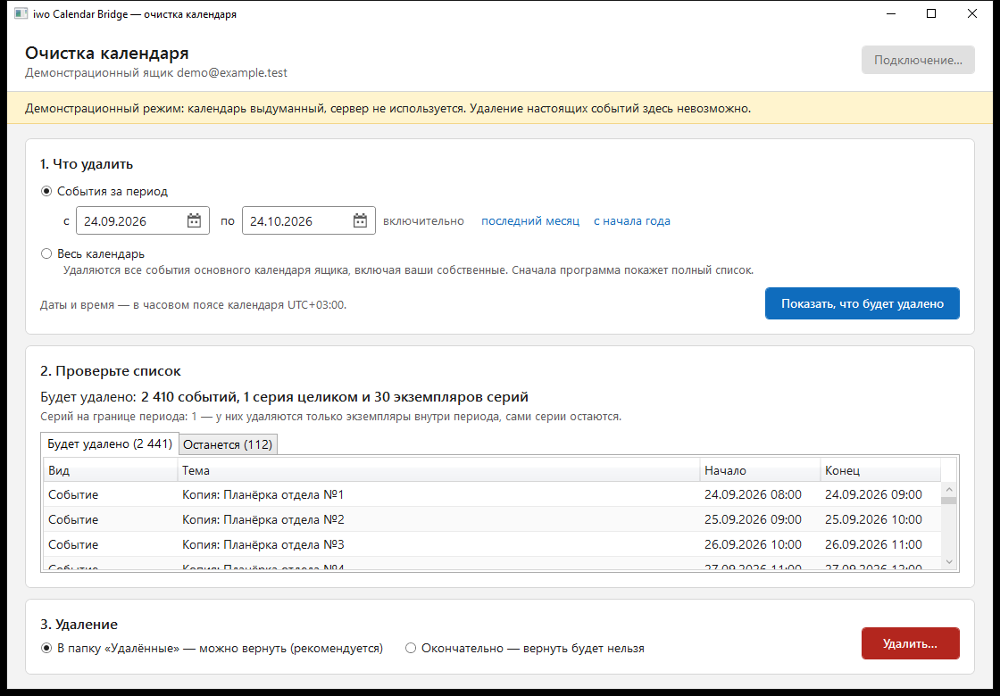
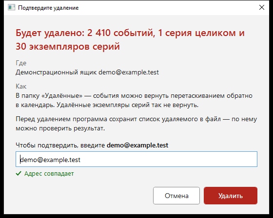
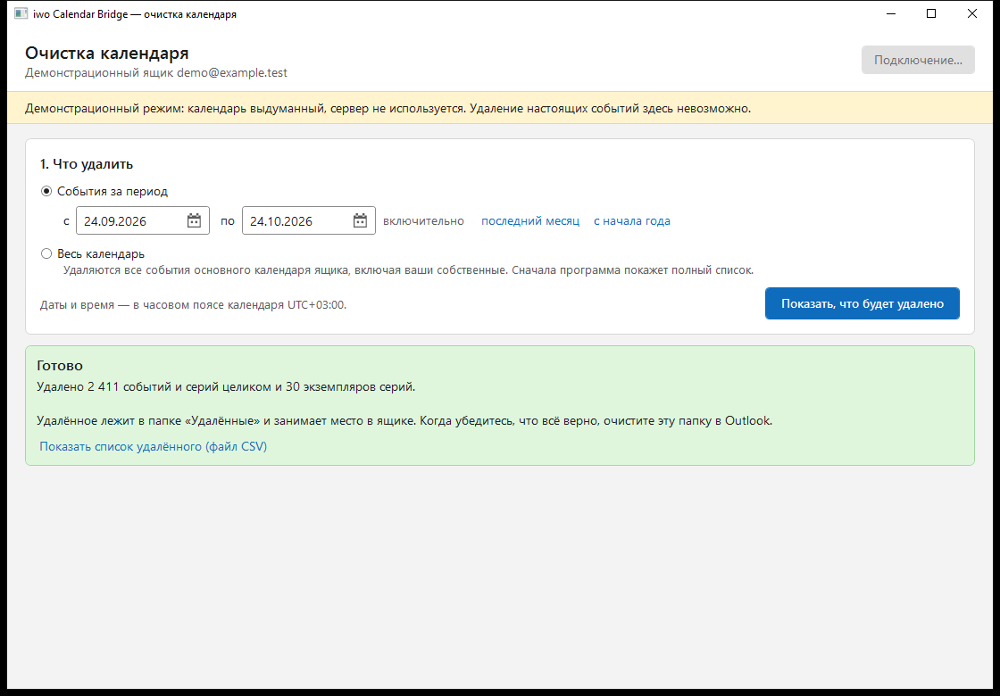

# iwo Calendar Bridge

Перенос событий календаря между двумя доменами Microsoft Exchange: чтение из исходного календаря
(только чтение, через Outlook) и запись в основной календарь выбранного ящика приёмника (через EWS).
Десктопное приложение для Windows с графическим интерфейсом.

Первый выпуск — безопасная очистка основного календаря приёмника (от событий, оставленных прежними
инструментами). Затем — односторонняя синхронизация источник → приёмник с переносом вложений,
повторяющихся серий и исключений.

> **Мультиарендность.** Продукт не содержит данных какой-либо организации. Адрес сервера, ящик,
> часовой пояс, отпечаток сертификата и учётные данные задаёт пользователь в окне «Подключение»;
> в исходном коде, документации, тестах и логах таких значений нет.

## Возможности

- Очистка основного календаря: весь календарь или период, с предпросмотром списка, подтверждением вводом
  адреса ящика, ходом работы, остановкой и итогом.
- Строгая защита от потери данных: удаление только по полностью прочитанному календарю и только того, что
  было показано в предпросмотре; перед удалением — список удаляемого в файл.
- Подключение из окна программы: сервер (внутренний или внешний адрес — имя, IP, с портом или полный адрес
  EWS), необязательный резервный адрес с автоматическим переходом при недоступности основного, ящик, учётная
  запись, пароль, часовой пояс; проверка подключения с показом сертификата сервера.
- Закрепление сертификата сервера (pinning) и распознавание перехвата HTTPS антивирусом/прокси.
- Пароль хранится только в диспетчере учётных данных Windows (DPAPI).
- Односторонняя синхронизация (в разработке): копии с вложениями, серии с исключениями, защита от дублей.

## Как это выглядит

Снимки сделаны в демонстрационном режиме (`IwoCalendarBridge.exe --demo`): календарь выдуманный, сервер не
используется.

**Предпросмотр.** Сначала программа показывает, что будет удалено и что останется, — ничего не удаляя.



**Подтверждение.** Удалить можно только после ввода адреса ящика; кнопка по умолчанию — «Отмена».



**Итог.** Сколько удалено и где лежит список удалённого (CSV).



**Подключение.** Основной и необязательный резервный адрес сервера, у каждого свой сертификат.


## Статус

Выпуск R1 (очистка) — программа с окнами готова и проверена тестами и в демонстрационном режиме; впереди
проверка на настоящем сервере (интеграционные тесты на тестовой подпапке).

- **Ядро `IwoBridge.Core`** — планирование очистки (одиночные события, серии целиком, обрезка серий на
  границе периода с учётом перенесённых исключений), единое правило попадания в период, постраничное чтение
  с якорным элементом, строгая оценка удаления, классификация ошибок, политика сертификата, разбор адреса
  сервера.
- **Сценарий `IwoBridge.App`** — предпросмотр → подтверждение → свежая сверка → манифест → удаление только
  подтверждённого, с ходом работы и остановкой между пакетами; чтение и запись `config/connection.json`.
- **Адаптер `IwoBridge.Ews`** — EWS Managed API: проверка подключения, перечисление, данные серий,
  раскрытие окна, удаление, проверка сертификата, учётные данные в диспетчере Windows.
- **Приложение `IwoBridge.Wpf`** — окна очистки, «Подключение» и подтверждения удаления (WPF, MVVM).
- **Ин-мемори адаптер `IwoBridge.InMemory`** — демонстрационный режим и тесты без сервера.
- **Синхронизация (R2, начато)** — в ядре готов планировщик точечной перезаписи за период: создаётся новое,
  перезаписывается изменённое, удаляются копии удалённого, неизменённое и чужое не трогается.
- **Тесты** — 591 (ядро, сценарий, адаптер EWS, модели и разметка окон, архитектурные правила), на
  синтетических данных; CI на GitHub Actions.

## Требования

- Windows 7 SP1, 8.1, 10 или 11, 32- или 64-разрядная.
- .NET Framework 4.8 (входит в Windows 10 1903+ и 11; на Windows 7 SP1 и 8.1 устанавливается отдельно,
  на Windows 7 — после обновлений поддержки подписи SHA-2). Без него Windows при запуске предложит
  установку.
- Приёмник: Microsoft Exchange 2007 SP2 … 2013 (последний накопительный пакет), доступ по EWS.
- Защищённое соединение: протокол выбирает Windows. Exchange 2007 работает по TLS 1.0 — он должен быть
  разрешён в Windows. Если сервер принимает только TLS 1.2, на Windows 7 его нужно включить в реестре
  (по умолчанию там включён только TLS 1.0).

## Установка и запуск

Программа переносная: распакуйте архив в папку, доступную на запись (например, в профиле пользователя, не в
Program Files), и запустите `IwoCalendarBridge.exe`. Две сборки по разрядности:

| Архив | Для какой Windows |
|---|---|
| `iwo-Calendar-Bridge-x64.zip` | 64-разрядной (рекомендуется) |
| `iwo-Calendar-Bridge-x86.zip` | 32-разрядной (работает и на 64-разрядной) |

При первом запуске откроется окно «Подключение». Одновременно работает один экземпляр программы.

Посмотреть программу без сервера можно в демонстрационном режиме — выдуманный календарь в памяти, удаление
настоящих событий невозможно:

```powershell
IwoCalendarBridge.exe --demo
```

## Подключение

Окно «Подключение» (кнопка вверху главного окна):

| Поле | Что вводить |
|---|---|
| Сервер | Внутренний или внешний адрес сервера Exchange: имя (`mail.example.ru`), IP-адрес, с портом через двоеточие (`mail.example.ru:8443`) или полный адрес EWS из Outlook. Нужен `https` — его можно не писать |
| Резервный сервер | Необязательно. Второй адрес того же сервера в том же виде — например, внешний, если основной внутренний. Программа переходит на него сама, только если основной недоступен по сети (нет связи, соединение отклонено, нет ответа). При ошибке входа, прав или сертификата не переходит: по другому адресу ответил бы тот же сервер, а повтор входа приближает блокировку учётной записи |
| Ящик | SMTP-адрес ящика, календарь которого очищается. Пусто — ящик учётной записи входа |
| Учётная запись | `ДОМЕН\пользователь` или `пользователь@домен` |
| Пароль | Хранится только в диспетчере учётных данных Windows. Пустое поле при сохранённом пароле — «не менять» |
| Часовой пояс | Пояс, в котором живёт календарь ящика. От него считаются границы периода очистки |

«Сохранить» сначала проверяет подключение — каждый адрес отдельно. Если ответивший адрес сообщает об ошибке
(вход, права, сертификат), настройки не сохраняются. Один недоступный адрес сохранению не мешает (внутренний
вне офиса — нормально); если недоступны все, программа предложит сохранить настройки без проверки. Если Windows
не доверяет сертификату сервера (так бывает с собственным сертификатом Exchange), окно покажет его — сверьте
отпечаток SHA-256 с администратором и нажмите «Доверять этому сертификату». Доверие у каждого адреса своё; при
смене адреса доверие к прежнему не переносится на новый.

Настройки сохраняются в `config/connection.json` рядом с программой, пароль — в диспетчер учётных данных
Windows под именем `IwoCalendarBridge/ews`. Файл можно заполнить и вручную по шаблону
`config/connection.example.json` (поля `ewsUrl`, `mailboxAddress`, `utcOffset` вида `+ЧЧ:ММ`,
`pinnedCertificateThumbprint`, необязательные `alternateEwsUrl` и `alternatePinnedCertificateThumbprint`), а
пароль занести командой:

```powershell
cmdkey /generic:IwoCalendarBridge/ews /user:<ДОМЕН>\<пользователь> /pass
```

## Очистка

1. **Что удалить** — период (первый и последний день включительно, быстрые варианты «последний месяц» и
   «с начала года») или весь календарь.
2. **Показать, что будет удалено** — программа читает календарь и показывает два списка: «Будет удалено» и
   «Останется» с причиной. Серии целиком в периоде удаляются целиком; у серий на границе периода — только
   экземпляры внутри него.
3. **Удалить…** — в папку «Удалённые» (можно вернуть, по умолчанию) или окончательно. Подтверждается вводом
   адреса ящика; окончательное удаление — ещё и отметкой. «Остановить» прерывает удаление после текущего
   пакета; повторный запуск доводит дело, уже удалённое пропускается.

Перед удалением программа записывает CSV-файл со списком удаляемого: вид, тема, начало и конец в поясе
приёмника, идентификатор. Файл открывается в Excel двойным щелчком (кнопка «Показать список удалённого»).
Если записать его нельзя, удаление не выполняется. Файлы `cleanup-ГГГГММДД-ччммссZ-xxxxxxxx.csv` лежат в
папке `manifests` рядом с программой и содержат темы событий — удалите их, когда они больше не нужны
(см. [политику конфиденциальности](docs/PRIVACY.md)).

## Сборка и тесты

Нужен .NET SDK 8 или новее (референсные сборки .NET Framework подтягиваются NuGet-пакетом, Developer Pack не
обязателен).

```powershell
dotnet build IwoBridge.sln
dotnet test  IwoBridge.sln
powershell -ExecutionPolicy Bypass -File build\package.ps1   # сборки x86 и x64 в artifacts\
```

Версии пакетов зафиксированы в `packages.lock.json` каждого проекта. После изменения `PackageReference`
выполните `dotnet restore IwoBridge.sln` и закоммитьте изменившиеся lock-файлы, иначе CI упадёт на
восстановлении (`--locked-mode`).

CI (`.github/workflows/ci.yml`) на каждый push и pull request: восстановление по lock-файлам, сборка Release,
все тесты, сборки x86 и x64 (артефакт `iwo-Calendar-Bridge`), результаты тестов (артефакт `test-results`).
Сервер Exchange и данные установки в CI не используются.

## Документация

- [Архитектура](docs/ARCHITECTURE.md) — слои, компоненты ядра, адаптеры, окна, потоки данных.
- [План проекта](docs/PLAN.md) — цель, границы, правила переноса, совместимость, реестр ловушек.
- [План работ](docs/WORKPLAN.md) — этапы, критерии готовности, зависимости.
- [Журнал решений](docs/DECISIONS.md) — принятые решения и их причины.
- [Журнал изменений](docs/CHANGELOG.md) — что сделано по этапам.
- [Политика конфиденциальности](docs/PRIVACY.md) — какие данные обрабатываются и где хранятся.

## Лицензия

Распространяется на условиях [GNU General Public License v3.0](LICENSE).
