<div align="center">

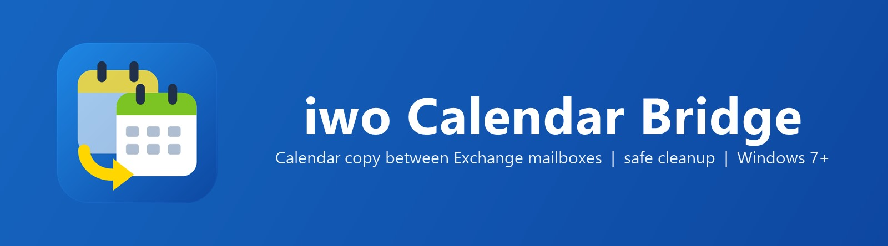

<br>

[](https://github.com/DedovMosol/iwo-Calendar-Bridge/actions/workflows/ci.yml) [](https://github.com/DedovMosol/iwo-Calendar-Bridge/releases/latest) [](https://github.com/DedovMosol/iwo-Calendar-Bridge/releases) [](LICENSE) [](docs/PRIVACY.md)

**Одностороннее копирование календаря Exchange: Outlook (MAPI/COM) или EWS → EWS. Инкрементальная синхронизация за период, серии с исключениями, вложения. Очистка календаря по EWS с предпросмотром и манифестом. Exchange 2007 SP2…2013, Windows 7 SP1…11, x86/x64, portable.**

📐 [Архитектура](docs/ARCHITECTURE.md) · 🤝 [Участие](CONTRIBUTING.md) · 📋 [Изменения](docs/CHANGELOG.md) · 🔒 [Конфиденциальность](docs/PRIVACY.md)

</div>

<div align="center">

**Содержание** — 🚀 [Функции](#-функции) · 📸 [Скриншоты](#-скриншоты) · ⬇️ [Скачать](#️-скачать) · 🖥️ [Использование](#️-использование)<br>⚙️ [Конфигурация](#️-конфигурация) · 🧰 [Развёртывание](#-развёртывание) · 🏗️ [Архитектура](#️-архитектура) · 🛠️ [Сборка](#️-сборка-и-тесты) · 🗺️ [Статус](#️-статус) · ⚖️ [Лицензия](#️-лицензия)

</div>

## Обзор

iwo Calendar Bridge — WPF-клиент (.NET Framework 4.8) для двух операций над календарями Exchange:

| Операция | Источник | Приёмник | Протокол записи |
|---|---|---|---|
| **Копирование** | Любой календарь из Outlook на этом компьютере (свой, другого ящика профиля, из «Общих календарей») либо календарь ящика на сервере Exchange по EWS | ящик по EWS | EWS Managed API 2.2 |
| **Очистка** | — | любой ящик, подключённый по EWS (приёмник или источник) | EWS Managed API 2.2 |

Типовой сценарий: календарь доступен в Outlook (например, общий ящик другого домена без EWS снаружи), а
нужен в собственном ящике на другом сервере. Источник только читается; в приёмнике изменяются только копии,
созданные программой.

- **Portable**: развёртывание копированием каталога, без инсталлятора и прав администратора.
- **Без привязки к организации**: адреса серверов, ящики, часовой пояс календаря, закреплённые сертификаты и
  учётные данные задаются в конфигурации; в бинарниках и репозитории их нет.
- **Сеть**: только HTTPS до указанных серверов EWS. Телеметрии, автообновления и сторонних сервисов нет.

## 🚀 Функции

### 🔄 Копирование (Outlook | EWS → EWS)

Синхронизация за период `[start, end]`, по одному проходу на запуск: предпросмотр плана → выбор строк →
применение.

| Изменение в источнике | Действие в приёмнике |
|---|---|
| Новое событие | Create |
| Изменён одиночный элемент | Update на месте |
| Изменена серия (правило, исключения) | Delete + Create серии |
| Удалено / вышло из выборки | Delete копии |
| Без изменений | Skip |
| Дубли одной копии | Delete лишних |

<details><summary><b>Сопоставление, отпечаток, защита от ошибок чтения</b></summary>

- **Метки копий** — extended properties в приёмнике: `IwoBridgeSourceId` (GlobalAppointmentID источника,
  при отсутствии — EntryID/ItemId) и `IwoBridgeContentHash` (SHA-256 канонизированного содержимого: тема,
  время, all-day, место, тело, FreeBusy, Sensitivity, правило повтора, исключения, вложения). Элементы без
  метки планировщик не видит и не изменяет.
- **Перенос за границу периода** — копия обновляется, а не удаляется.
- **Неполное чтение источника** (обрыв, таймаут, `Incomplete`) — удаления из плана исключаются.
- **Mass-delete guard**: > 20 удалений за прогон, > 10 % копий периода или пустой источник при непустых
  копиях — план блокируется до явного подтверждения в UI.
- **Ошибки** классифицируются: аутентификация, права, ящик, endpoint, сертификат, TLS, квота, соединение,
  таймаут, `ServerBusy` прерывают пакет; прочие — ошибка элемента, прогон продолжается, сбойные строки
  выводятся в итоге.

</details>

<details><summary><b>Преобразование элементов</b></summary>

- **Встречи** пишутся как Appointment без участников; `SendInvitationsMode.SendToNone` — приглашения и
  уведомления не рассылаются.
- **Private** (Sensitivity = Private) → тема «Личное», без места, тела и вложений; время и FreeBusy сохраняются.
- **Напоминания** в копиях отключены.
- **Серии**: Daily / Weekly / Monthly (absolute, relative) / Yearly, с исключениями и удалёнными вхождениями.
- **Часовой пояс записи** — фиксированное смещение календаря приёмника; используются классические ID зон
  Windows без DST (совместимость со схемой Exchange 2007). All-day пишутся как локальные полночи.
- **Outlook-источник**: позднее связывание COM (`dynamic`) без Office Interop — нет привязки к версии и
  разрядности Office. Подключение только к запущенному `outlook.exe` (`GetActiveObject`), STA-поток с
  `IOleMessageFilter`, чтение через `Folder.GetTable()` с DASL-колонками, освобождение всех RCW. Участники
  не читаются — Outlook Object Model Guard не срабатывает.
- **Какие календари Outlook доступны**: всё из панели «Календарь» (`NavigationPane`, включая «Общие
  календари»), основные календари хранилищ профиля и их подпапки первого уровня. По умолчанию выбран открытый
  сейчас в Outlook. Поиск по тексту: подстрока названия в списке, затем владелец через адресную книгу
  (`CreateRecipient` → `GetSharedDefaultFolder`).
- **Повреждённые исключения серий**, которые Outlook не открывает (`Exception.AppointmentItem` и
  `GetOccurrence` падают), переносятся как удалённые повторения и перечисляются в предпросмотре; чтение при
  этом считается полным.

</details>

### ⏱️ Автокопирование

«Раз в N» (5 мин … сутки): план за скользящий период (дни назад и вперёд от текущей даты) применяется без вопросов.
Работает из области уведомлений, есть автозапуск при входе в Windows (`HKCU\…\Run`, без прав администратора).

<details><summary><b>Правила расписания</b></summary>

- Запуски не накладываются; пока идёт другая операция или открыт любой вопрос программы, запуск откладывается на минуту.
- Ошибки входа, прав, сертификата, TLS — расписание **приостанавливается** до правки подключения (защита от блокировки
  учётной записи); сеть и `ServerBusy` — повтор по расписанию.
- Mass-delete guard в автоматическом режиме не обходится: план не применяется, человеку уходит уведомление.
- Выбранный календарь Outlook узнаётся по EntryID папки; если его нет, он **не подменяется** другим.
- Outlook перезапустили — подключение восстанавливается; вызов COM завис — сторож (10 мин) завершает его ошибкой и
  заменяет STA-поток. Все RCW освобождаются сразу.
- Одно уведомление на одну и ту же проблему.

</details>

### 👤 Свои события, личные, вложения

- **События, созданные человеком в приёмнике**, не изменяются и не удаляются никогда. Если там уже есть такое же
  (тема, начало, конец, вид), копия по умолчанию не создаётся — строка плана без отметки «У вас уже есть такое же».
- **Private / Confidential** — на выбор: только «занято» (по умолчанию), полностью, не копировать.
- **Описание** переносится исходным RTF (`PR_RTF_COMPRESSED`, без сжатия): шрифты, таблицы, вставленные картинки.
  **Вложения**: файлы и вложенные элементы (`.msg`); ссылки и OLE — с замечанием в плане.
- Копия атомарна: при сбое на вложениях или исключениях серии созданная копия удаляется, у перезаписи отпечаток
  пишется последним запросом — недописанная копия перезапишется при следующем запуске.
- Копии моста в источнике не читаются (защита от «копий копий» при встречной настройке); источник и приёмник —
  один ящик — отказ.

### 🧹 Очистка (EWS)

Весь основной календарь или период (границы включительно). Предпросмотр «Будет удалено» / «Останется» с
причиной, удаление `MoveToDeletedItems` или `HardDelete`, пакетами по 50 с остановкой после текущего пакета.

<details><summary><b>Инварианты удаления</b></summary>

- Перед удалением календарь перечитывается; удаляется пересечение с предпросмотром. Добавленное или
  изменённое после предпросмотра не удаляется и попадает в итог.
- Удаление только по полному снимку: постраничное чтение с якорем, детект сдвига страниц, до 3 перезапусков.
  Неполный снимок блокирует операцию.
- Подтверждение вводом SMTP-адреса ящика; для `HardDelete` — дополнительный флажок. Default-кнопка
  диалога — «Отмена».
- CSV-манифест пишется до первого запроса на удаление; ошибка записи — отказ от операции.
- Серия целиком в периоде удаляется мастером; пересекающая границу — только вхождения внутри периода
  (с учётом перенесённых исключений).
- Повреждённые элементы не удаляются, выводятся в «Останется».
- Retry с backoff только для transient-ошибок (сеть, `ServerBusy`); 401 не повторяется — защита от
  блокировки учётной записи.

</details>

### 🔌 Подключение EWS

Два независимых профиля: **приёмник** и **источник по EWS** (необязательный). Каждый: основной и резервный
endpoint, ящик (impersonation не используется — права делегата), учётная запись, смещение пояса календаря.

<details><summary><b>Endpoint, failover, TLS, учётные данные</b></summary>

- **Endpoint** нормализуется из имени, IP, `host:port` или полного URL `/EWS/Exchange.asmx`; схема — только
  `https`.
- **Failover** на резервный адрес — только при сетевой недоступности основного (connect refused, DNS,
  timeout). Ошибки аутентификации, прав, сертификата и TLS failover не вызывают.
- **Certificate pinning**: отпечаток SHA-256 (или SHA-1) закрепляется отдельно для каждого endpoint;
  `RemoteCertificateNameMismatch` допускается (подключение по IP), прочие ошибки цепочки — только при
  совпадении pin. Подмена сертификата HTTPS-инспекцией антивируса/прокси детектируется.
- **Учётные данные** — Windows Credential Manager (DPAPI, текущий пользователь); в файлах конфигурации
  пароля нет.
- **Проверка подключения** — по каждому адресу отдельно: GetFolder(Calendar), число элементов, параметры
  сертификата; детальная цепочка ошибки для администратора.

</details>

### Прочее

- 🖥️ **UI** от 720×480 до 4K; размер окон ограничивается рабочей областью (масштаб 125–150 %); DataGrid с
  виртуализацией строк (тысячи элементов).
- 📖 **Встроенная справка** (F1, кнопка «Справка»): по шагам для человека, который видит программу впервые; поиск Ctrl+F.
- ⌨️ **Клавиатура**: F1 — справка, F5 — предпросмотр активной вкладки, Esc — остановка, уникальные Alt-клавиши.
- ♿ **Доступность**: High Contrast применяется на лету, live regions для экранного диктора.
- 🧪 **`--demo`**: приёмник, источник и «Outlook» в памяти, без сети.
- 📝 **`logs\crash.log`** — необработанные исключения, локально.
- 🔒 Single instance на сеанс пользователя.

## 📸 Скриншоты

Демонстрационный режим (`--demo`), данные синтетические.

**Копирование**

|  |  |
|:--:|:--:|
| 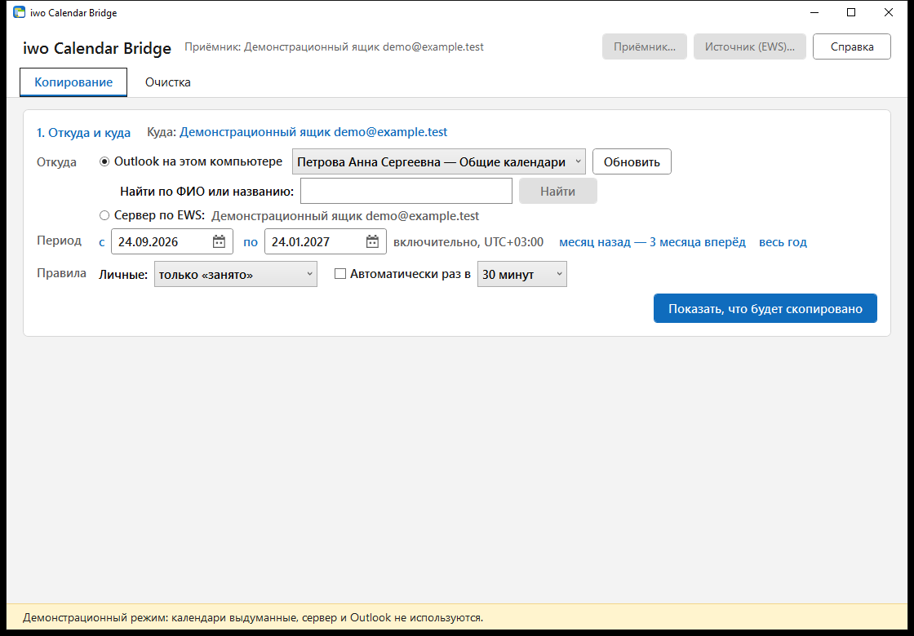<br>**Источник**: календарь Outlook (включая «Общие календари») или EWS, поиск по ФИО, период | 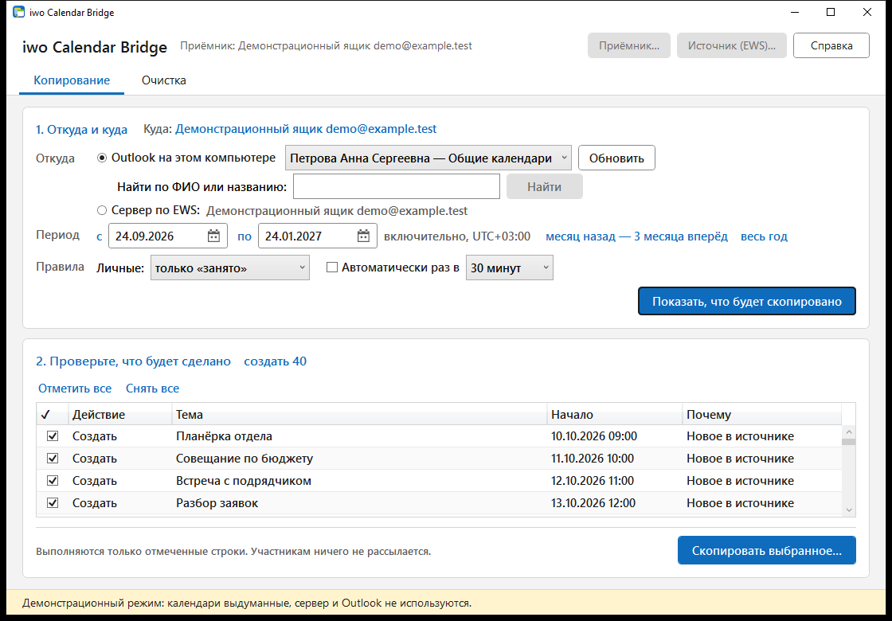<br>**План**: действие на строку, выбор флажками |
| 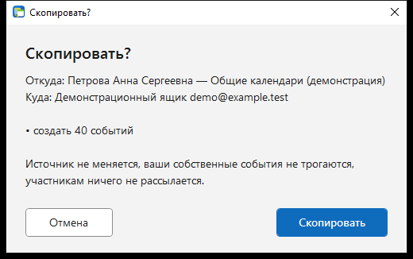<br>**Подтверждение**: откуда, куда, счётчики | 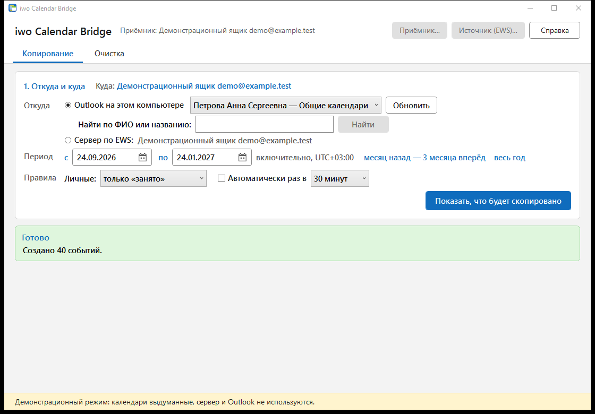<br>**Итог**: записано и сбои по событиям |

**Очистка**

|  |  |
|:--:|:--:|
| 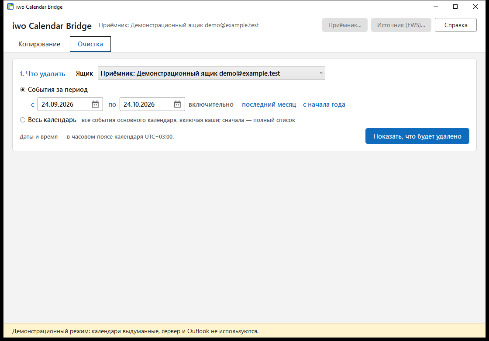<br>**Ящик и период** | 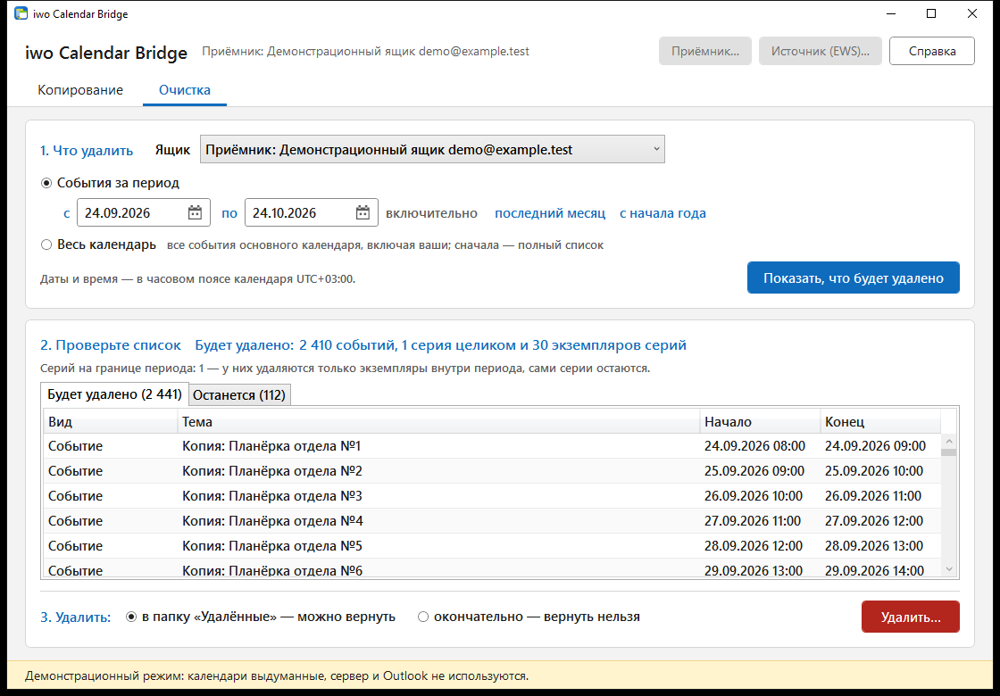<br>**Предпросмотр**: «Будет удалено» / «Останется» |
| 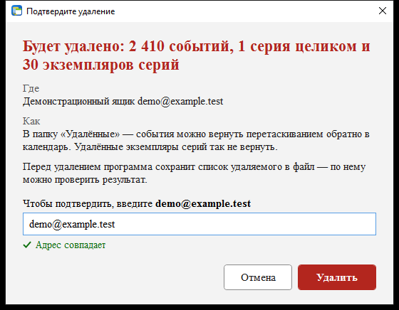<br>**Подтверждение** вводом адреса ящика | 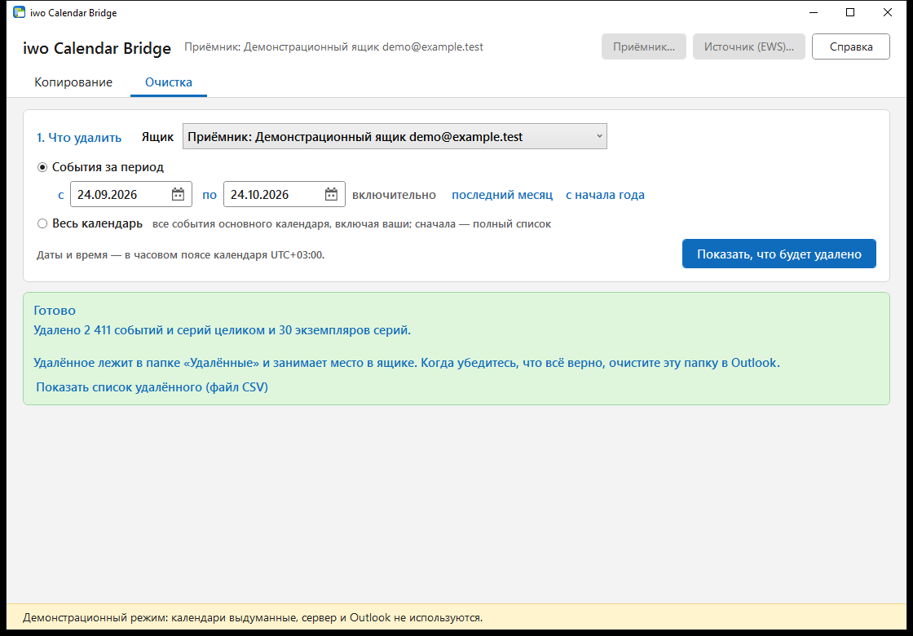<br>**Итог** и CSV-манифест |

**Подключение и справка**

|  |  |
|:--:|:--:|
| 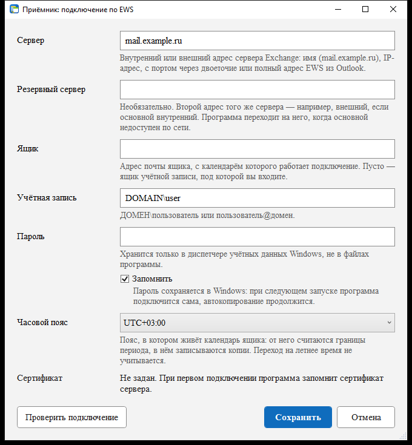<br>**Приёмник**: основной и резервный endpoint | 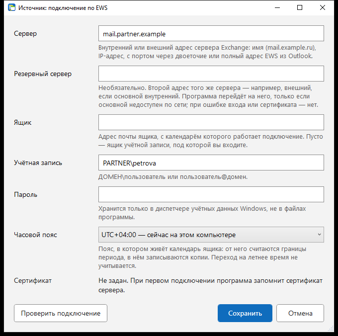<br>**Источник по EWS** (если не Outlook) |
| 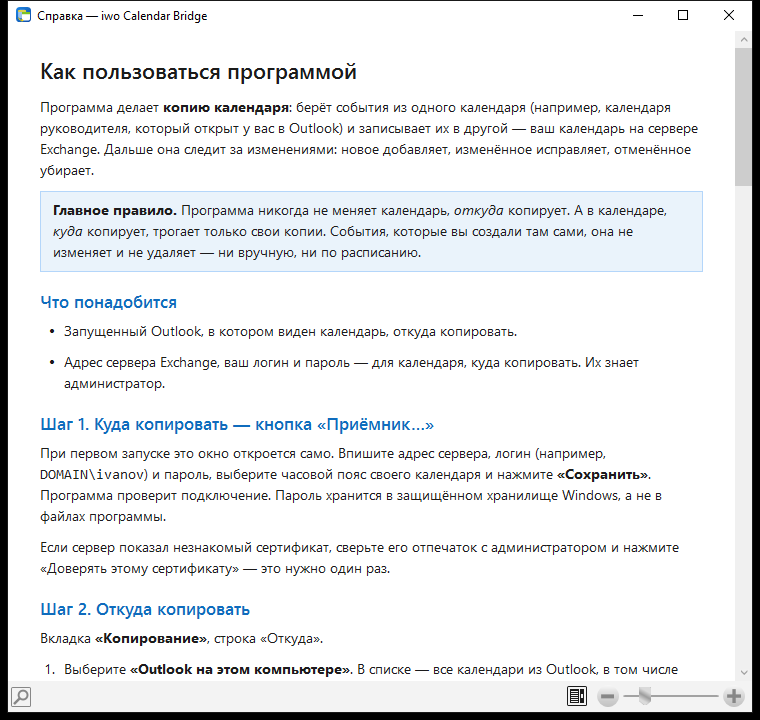<br>**Справка** (F1): по шагам, без интернета | |

## ⬇️ Скачать

| Архитектура | Архив |
|----|----------|
| **x64** — Windows 7 SP1 / 8.1 / 10 / 11 | [](https://github.com/DedovMosol/iwo-Calendar-Bridge/releases/latest/download/iwo-Calendar-Bridge-x64.zip) |
| **x86** — 32-битные Windows 7 SP1 / 8.1 / 10 (работает и на x64) | [](https://github.com/DedovMosol/iwo-Calendar-Bridge/releases/latest/download/iwo-Calendar-Bridge-x86.zip) |

Все артефакты — на [странице релизов](https://github.com/DedovMosol/iwo-Calendar-Bridge/releases/latest).
Распакуйте в каталог с правом записи (не `Program Files`): `config\`, `manifests\`, `logs\` создаются рядом
с `IwoCalendarBridge.exe`. Функционально сборки идентичны; разрядность Outlook на выбор сборки не влияет
(COM out-of-process).

## 🖥️ Использование

1. **Приёмник…** — профиль EWS, куда копировать. При первом запуске окно открывается автоматически.
2. **Источник (EWS)…** — только если источник не Outlook этого ПК.
3. Вкладка **Копирование**: источник — календарь Outlook (по умолчанию открытый сейчас в Outlook; чужой
   общий календарь — поле «Найти по ФИО или названию») или EWS, период → **Показать, что будет скопировано**
   (F5) → выбор строк плана → **Скопировать выбранное…** → итог по каждой строке.
4. Вкладка **Очистка**: ящик, период или весь календарь → **Показать, что будет удалено** (F5) →
   **Удалить…** → подтверждение адресом ящика → итог и CSV-манифест.

Для источника Outlook клиент должен быть запущен в том же сеансе пользователя: программа не стартует Outlook
и не меняет профиль. Повторный запуск копирования за тот же период идемпотентен.

```text
IwoCalendarBridge.exe          обычный режим
IwoCalendarBridge.exe --demo   демонстрационный режим, без сети
```

## ⚙️ Конфигурация

| Профиль | Файл | Credential Manager (Generic) |
|---|---|---|
| Приёмник | `config\connection.json` | `IwoCalendarBridge/ews` |
| Источник по EWS | `config\source-connection.json` | `IwoCalendarBridge/ews-source` |
| Копирование и расписание | `config\copy.json` (источник, календарь Outlook, период в днях, правило личных, интервал) | — |

Шаблон — `config\connection.example.json`. Поля: `ewsUrl`, `alternateEwsUrl`, `mailboxAddress`,
`utcOffset` (`+ЧЧ:ММ`), `pinnedCertificateThumbprint`, `alternatePinnedCertificateThumbprint`. Пароль без UI:

```powershell
cmdkey /generic:IwoCalendarBridge/ews        /user:<DOMAIN>\<user> /pass
cmdkey /generic:IwoCalendarBridge/ews-source /user:<DOMAIN>\<user> /pass
```

<details><summary><b>Поля окна «Подключение»</b></summary>

| Поле | Формат |
|---|---|
| Сервер | FQDN, IP, `host:port` или URL EWS. Схема `https` подставляется |
| Резервный сервер | Необязательно. Альтернативный endpoint того же сервера, используется только при сетевой недоступности основного |
| Ящик | SMTP-адрес. Пусто — ящик учётной записи |
| Учётная запись | `DOMAIN\user` или UPN |
| Пароль | Сохраняется в Credential Manager. Пустое поле при сохранённом пароле — без изменений |
| Часовой пояс | Смещение UTC календаря ящика; используется для границ периода и записи |

«Сохранить» выполняет проверку каждого endpoint. Ответ с ошибкой (401, права, сертификат) блокирует
сохранение; недоступность одного адреса — нет; недоступность всех — сохранение без проверки по
подтверждению. Недоверенный сертификат показывается с SHA-256/SHA-1 для сверки и закрепления.

</details>

<details><summary><b>Манифест очистки</b></summary>

`manifests\cleanup-YYYYMMDD-HHmmssZ-xxxxxxxx.csv`: UTF-8 с BOM, разделитель — `ListSeparator` текущей
культуры, запись через временный файл, экранирование формул (CSV injection). Колонки: тип, тема, начало,
конец (в поясе календаря), ItemId. Содержит темы событий — храните и удаляйте по политике организации.

</details>

## 🧰 Развёртывание

| Параметр | Значение |
|---|---|
| Сервер | Exchange 2007 SP2 … 2013, `/EWS/Exchange.asmx`; запросы со схемой `Exchange2007_SP1` |
| Сеть | HTTPS (443 или порт из URL) до заданных endpoint, системный прокси. Иных соединений нет |
| Аутентификация | NTLM / Negotiate, доменная учётная запись |
| Права в приёмнике | Calendar: Read, Create, Edit, Delete (своё — по умолчанию; чужой ящик — делегирование на папку) |
| Права в источнике | EWS: Read на Calendar. Outlook: доступ к хранилищу в профиле |
| TLS | Версию выбирает SChannel. Exchange 2007 — TLS 1.0 должен быть разрешён на клиенте; сервер только с TLS 1.2 на Windows 7 — включить TLS 1.2 в SChannel и `SystemDefaultTlsVersions` для .NET |
| HTTPS-инспекция | Добавить серверы Exchange в исключения, иначе pin не совпадёт и подключение будет отклонено |
| Клиент | Windows 7 SP1 … 11, .NET Framework 4.8 (на Windows 7 — после обновлений SHA-2). Права администратора не нужны |
| Outlook (опционально) | Версия с Outlook Object Model, любая разрядность; запущен в сеансе пользователя |
| Локальные данные | `config\*.json` (без паролей), `manifests\*.csv`, `logs\crash.log` |

## 🏗️ Архитектура

Ports & adapters, зависимости направлены внутрь (контролируются архитектурными тестами):

```text
IwoBridge.Wpf ──► IwoBridge.App ──► IwoBridge.Core
      │                                  ▲
      ├──► IwoBridge.Ews ────────────────┤   EWS Managed API 2.2
      ├──► IwoBridge.Outlook ────────────┤   COM late binding
      └──► IwoBridge.InMemory ───────────┘   demo, тесты
```

- **Core** — модель календаря, `SyncPlanner`, `CleanupPlanner`, порты `ISourceCalendar` / `ICopyTarget`,
  классификация ошибок, время и пояса. Без I/O.
- **App** — сценарии `CopyRunner`, `CleanupRunner`: предпросмотр, исполнение, прогресс, отмена.
- **Ews** — `EwsSource`, `EwsCopyTarget`, `EwsCalendarGateway`, `EwsChannel` (сериализация запросов,
  failover, retry), маппинг полей и правил повтора, pinning.
- **Outlook** — `OutlookSource`, STA-воркер, маппинг правил повтора.
- **Wpf** — MVVM без сторонних фреймворков.

Подробно — [ARCHITECTURE.md](docs/ARCHITECTURE.md), решения — [DECISIONS.md](docs/DECISIONS.md).

## 🛠️ Сборка и тесты

```powershell
dotnet build IwoBridge.sln
dotnet test  IwoBridge.sln
powershell -ExecutionPolicy Bypass -File build\package.ps1   # artifacts\iwo-Calendar-Bridge-x64|x86 (+ .zip)
```

.NET SDK 8+, target `net48`; reference assemblies — из NuGet (`Microsoft.NETFramework.ReferenceAssemblies`),
Developer Pack не требуется.

<details><summary><b>Тесты и CI</b></summary>

- **xUnit**, проекты `*.Tests` на каждый слой: планировщики и инварианты Core, сценарии App на in-memory
  адаптерах, маппинг и failover EWS на реальном HTTP-стеке, маппинг Outlook, UI — реальные окна off-screen
  на нескольких размерах (binding errors, достижимость кнопок, виртуализация, Alt-клавиши), архитектурные
  правила зависимостей. Только синтетические данные, сервер не нужен.
- **Live-тесты** (`LiveEwsCopyTests`, `LiveOutlookTests`, `LiveOutlookToEwsTests`) пропускаются, пока не
  заданы переменные окружения: `IWO_LIVE_EWS`, `IWO_LIVE_USER`, `IWO_LIVE_PASSWORD`, `IWO_LIVE_OFFSET`
  (необязательно `IWO_LIVE_MAILBOX`, `IWO_LIVE_PIN`) и `IWO_LIVE_OUTLOOK=1`. Запись идёт только во временную
  папку календаря, которая в конце удаляется; Outlook только читается.
- **CI** (`.github/workflows/ci.yml`, push и PR): `restore --locked-mode`, Release, тесты, упаковка x86/x64.
- **Lock-файлы**: `packages.lock.json` в каждом проекте; после изменения `PackageReference` —
  `dotnet restore IwoBridge.sln` и коммит lock-файлов.

</details>

## 🗺️ Статус

| Компонент | Состояние |
|---|---|
| Очистка по EWS | Готово. Проверено на Exchange 2007 SP2 / Windows Server 2003 R2 |
| Подключение EWS, failover, pinning | Готово. Проверено на Exchange 2007 SP2 |
| Копирование: планировщик, сценарий, UI | Готово, покрыто тестами |
| Копирование: запись в EWS | Готово. Live-тест на Exchange 2007 SP2 (временная папка): одиночные, весь день, Private, серия с удалённым и перенесённым повторением, вложение; повтор идемпотентен; update, delete, пересоздание серии |
| Копирование: источник Outlook → EWS | Готово. Live-тест: общий календарь из «Общих календарей» Outlook → Exchange 2007 SP2, 597 событий (370 серий, 99 с вложениями) за ~1,5 мин без сбоев; повторный план пуст |
| Копирование: источник EWS | Реализовано, покрыто тестами маппинга; live-чтение проверено (пустой календарь) |
| R3 — стабилизация | Длительные прогоны, сценарии отказов, приёмка |

План — [WORKPLAN.md](docs/WORKPLAN.md), изменения — [CHANGELOG.md](docs/CHANGELOG.md).

## 🔒 Конфиденциальность

Данные передаются только между заданными серверами Exchange и локальным Outlook. Телеметрии, аналитики,
учётных записей и автообновления нет. Пароли — в Credential Manager; конфигурация, манифесты и журнал — в
каталоге программы. Подробно — [PRIVACY.md](docs/PRIVACY.md).

## ⚖️ Лицензия

[GNU General Public License v3.0](LICENSE) © 2026 [DedovMosol](https://github.com/DedovMosol)

EWS Managed API 2.2 — лицензия MIT (Microsoft).
