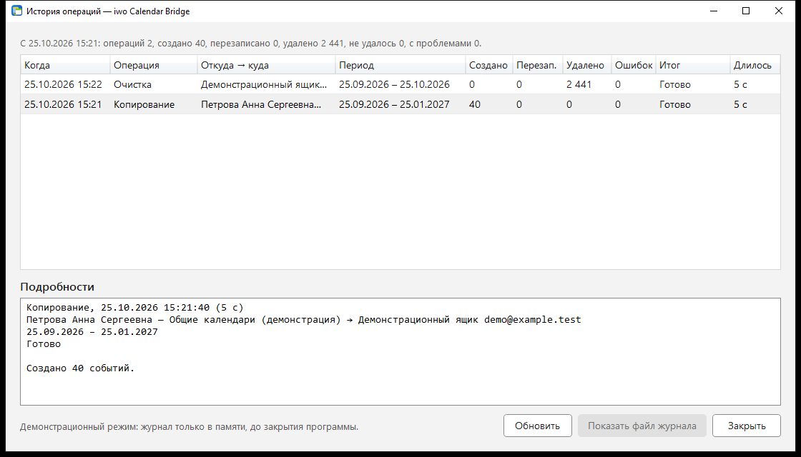
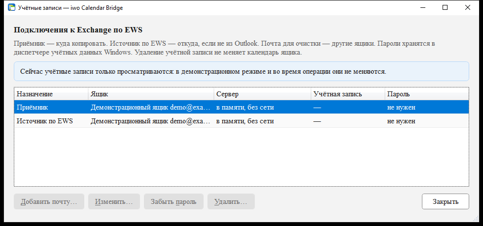

<div align="center">


<br>

[](https://github.com/DedovMosol/iwo-Calendar-Bridge/actions/workflows/ci.yml) [](https://github.com/DedovMosol/iwo-Calendar-Bridge/releases/latest) [](https://github.com/DedovMosol/iwo-Calendar-Bridge/releases) [](LICENSE) [](docs/PRIVACY.md)

**Одностороннее копирование календаря Exchange: Outlook (MAPI/COM) или EWS → EWS. Инкрементальная синхронизация за период, серии с исключениями, вложения, описание с оформлением, автокопирование по расписанию. Очистка календаря по EWS с предпросмотром и манифестом. Exchange 2007 SP2…2013, Windows 7 SP1…11, x86/x64, portable.**

📐 [Архитектура](docs/ARCHITECTURE.md) · 🤝 [Участие](CONTRIBUTING.md) · 📋 [Изменения](docs/CHANGELOG.md) · 🔒 [Конфиденциальность](docs/PRIVACY.md)

</div>

<div align="center">

**Содержание** — 🚀 [Функции](#-функции) · 📸 [Скриншоты](#-скриншоты) · ⬇️ [Скачать](#️-скачать) · 🖥️ [Использование](#️-использование)<br>⚙️ [Конфигурация](#️-конфигурация) · 🧰 [Развёртывание](#-развёртывание) · 🏗️ [Архитектура](#️-архитектура) · 🛠️ [Сборка](#️-сборка-и-тесты) · 🗺️ [Статус](#️-статус) · ⚖️ [Лицензия](#️-лицензия)

</div>

<div align="justify">

## Обзор

iwo Calendar Bridge — WPF-клиент (.NET Framework 4.8) для двух операций с календарями Exchange:

| Операция | Источник | Приёмник | Протокол записи |
|---|---|---|---|
| **Копирование** | Любой календарь из Outlook на этом компьютере (свой, другого ящика профиля, из «Общих календарей») либо календарь ящика на сервере Exchange по EWS | ящик по EWS | EWS Managed API 2.2 |
| **Очистка** | — | любой ящик по EWS: приёмник, источник или добавленная почта | EWS Managed API 2.2 |

Типовой сценарий: календарь доступен в Outlook (например, общий ящик другого домена), а нужен в собственном
ящике на другом сервере. Источник только читается. В приёмнике программа работает только со своими копиями.

- **Portable.** Установка — копирование каталога, права администратора не нужны.
- **Конфигурация.** Серверы, ящики, часовой пояс календаря, сертификаты и учётные данные задаёт пользователь.
- **Сеть.** Только HTTPS до заданных серверов EWS, без телеметрии и автообновления.

## 🚀 Функции

### 🔄 Копирование (Outlook | EWS → EWS)

Синхронизация за период `[start, end]` или за всё время (весь допустимый диапазон дат EWS, 1601–4500): предпросмотр
плана → выбор строк → применение.

| Изменение в источнике | Действие в приёмнике |
|---|---|
| Новое событие | Create |
| Изменён одиночный элемент | Update на месте |
| Изменена серия (правило, исключения) | Delete + Create серии |
| Удалено или вышло из выборки | Delete копии |
| Без изменений | Skip |
| Несколько копий одного события | Delete лишних |

<details><summary><b>Сопоставление и отпечаток</b></summary>

- **Метки копий** — extended properties в приёмнике: `IwoBridgeSourceId` (GlobalAppointmentID источника,
  при его отсутствии EntryID или ItemId) и `IwoBridgeContentHash` (SHA-256 канонизированного содержимого:
  тема, время, all-day, место, тело, RTF, FreeBusy, Sensitivity, категории, правило повтора, исключения, вложения).
  Категории и RTF входят в отпечаток, только если они есть: у событий без них отпечаток тот же, что в прежних версиях.
- **Перенос за границу периода** — копия обновляется на месте.
- **Неполное чтение источника** (обрыв, таймаут) — план строится без удалений. Страницы перечня EWS
  перекрываются на один элемент: удаление или вставка во время чтения распознаются, и перечень читается заново.
- **Порог массового удаления**: больше 20 удалений за прогон, больше 10 % копий периода или пустой источник при
  непустых копиях — план выполняется только после явного подтверждения.
- **Ошибки** классифицируются. Аутентификация, права, ящик, endpoint, сертификат и TLS останавливают пакет
  сразу. Соединение, таймаут, квота и `ServerBusy` останавливают его, если повторились на следующем событии
  подряд, — одно крупное вложение не держит остальные. Остальное — ошибка отдельного элемента, она попадает в итог.
- **Повторы**: чтение и идемпотентная запись повторяются с паузой (с учётом `BackOffMilliseconds`) и переходят на
  резервный адрес. Создание события и добавление вложения не повторяются, на резервный адрес переходят, только
  если запрос не ушёл (отказ соединения, DNS).

</details>

<details><summary><b>Преобразование элементов</b></summary>

- **Встречи** пишутся как Appointment без участников, с `SendInvitationsMode.SendToNone`.
- **Напоминания** в копиях выключены.
- **Серии**: Daily, Weekly, Monthly (absolute и relative), Yearly, с изменёнными и удалёнными вхождениями.
- **Часовой пояс записи** — фиксированное смещение календаря приёмника, классические ID зон Windows без DST
  (схема Exchange 2007). All-day пишутся как местные полночи.
- **Описание** — исходный RTF (`PR_RTF_COMPRESSED` в несжатом формате MS-OXRTFCP): шрифты, таблицы, картинки.
  Текст и HTML для OWA и мобильных клиентов Exchange строит сам.
- **Вложения**: файлы и вложенные элементы Outlook (как `.msg`). Ссылки на файлы и объекты OLE перечисляются в
  замечаниях к плану.
- **Категории** (цветовые категории Outlook) переносятся названиями: `item:Categories` по EWS, у Outlook —
  многозначное `PidNameKeywords` через `PropertyAccessor` (запасной путь — строка `Categories`, разделённая
  разделителем списка Windows). У изменённого повторения переносятся его собственные категории. Категории копии
  задаёт источник: при перезаписи поставленные в приёмнике вручную заменяются.
- **Цвет категории** хранится не в событии, а в списке категорий почтового ящика (FAI `IPM.Configuration.CategoryList`
  папки «Календарь»). Копия окрашивается цветом категории с тем же названием из списка ящика-приёмника. EWS
  Exchange 2007 к этому списку доступа не даёт (нет `UserConfiguration` и обхода `Associated`), поэтому программа
  его не меняет. Стандартные категории Outlook совпадают сами. Свои категории нужно один раз создать в
  Outlook ящика-приёмника с тем же названием и цветом. Предпросмотр перечисляет категории копий с образцом цвета
  в источнике (у Outlook — `Store.Categories` и `Namespace.Categories`).
- **Снять у одного повторения категории серии** Exchange 2007 по EWS не позволяет: `DeleteItemField` у повторения
  отклоняется (`ErrorInvalidPropertyDelete`), пустой список не меняет поле. Такое повторение остаётся с
  категориями серии, итог копирования сообщает об этом один раз.
- **Запись атомарна**: событие создаётся с отметкой «не дописано», вложения добавляются по одному запросу на
  файл, затем исключения серии, отпечаток — последним. Сбой на любом шаге удаляет созданное. Если удалить не
  удалось, копия с отметкой «не дописано» перезаписывается при следующем запуске.
- **Пересоздание серии** — сначала новая копия, затем удаление прежней: сбой не теряет событие.
- **Исключения серии** находятся по UID серии и ближайшему началу (в пределах 12 часов, all-day — по местной
  дате). Изменённое повторение, которого нет в серии копии, остаётся как в правиле серии. Итог копирования
  перечисляет его в замечаниях один раз, следующий запуск копию не трогает.
- **Outlook-источник**: позднее связывание COM (`dynamic`) без Office Interop, без привязки к версии и
  разрядности Office. Подключение к запущенному `outlook.exe`, отдельный STA-поток с `IOleMessageFilter`,
  чтение через `Folder.GetTable()` с DASL-колонками, RCW освобождаются сразу. Участники и адреса не читаются.
- **Object Model Guard**: описание (`Body`, `RTFBody`) и столбцы таблицы Outlook защищает. При антивирусе в
  состоянии «Хорошо» в Центре безопасности Windows Outlook 2007 и новее доступ не запрашивает. Иначе Outlook
  показывает запрос «Программа пытается получить доступ…», и чтение ждёт ответа. Отказ делает событие
  непрочитанным, план строится без удалений.
- **Календари Outlook**: всё из панели «Календарь» (`NavigationPane`, включая «Общие календари»), основные
  календари хранилищ профиля и их подпапки первого уровня. По умолчанию выбран открытый сейчас. Поиск по
  тексту: подстрока названия в списке, затем владелец через адресную книгу (`GetSharedDefaultFolder`).
- **Изменённые вхождения серии, которые Outlook не открывает**, переносятся как удалённые и перечисляются в
  замечаниях к плану.

</details>

### ⏱️ Автокопирование

«Раз в N» (от 5 минут до суток): план за скользящий период (дни назад и вперёд от текущей даты) или за всё время
применяется без вопросов. За всё время каждый запуск читает календарь целиком. На большом календаре это дольше,
поэтому интервал лучше выбрать от часа. Программа работает из области уведомлений и может запускаться при входе в Windows
(`HKCU\…\Run`, без прав администратора).

<details><summary><b>Правила расписания</b></summary>

- Запуски идут строго по одному. Пока выполняется другая операция или открыт диалог, запуск переносится на минуту.
- Ошибка входа, прав, сертификата или TLS приостанавливает расписание до изменения подключения. Сетевые ошибки
  и `ServerBusy` повторяются по расписанию.
- План с превышением порога массового удаления не применяется, пользователь получает уведомление.
- Календарь Outlook выбирается по EntryID папки. Если он недоступен, запуск пропускается до его появления.
- После перезапуска Outlook подключение восстанавливается автоматически. Вызов COM ограничен по времени
  (10 минут), после чего STA-поток заменяется новым.
- Одна и та же проблема даёт одно уведомление.
- После сна компьютера и смены системного времени срок считается от последнего запуска. Просроченный запуск
  выполняется через минуту, когда поднимется сеть.
- Каждый выполненный или не начавшийся из-за ошибки запуск записывается в «Историю». Перенесённый запуск не
  записывается.

</details>

### 👤 События пользователя, личные события

- **События, созданные пользователем в приёмнике**, остаются без изменений. Если там уже есть событие с той же
  темой, началом, концом и видом, строка плана «Создать» снята по умолчанию с пометкой «У вас уже есть такое же».
- **Private и Confidential** — на выбор: только «занято» (по умолчанию: тема «Личное», без места, описания,
  вложений и категорий), полностью или не копировать. Личное повторение обычной серии получает категории серии,
  свои категории повторения не переносятся.
- **Копии программы** в источнике не читаются, поэтому встречная настройка A→B и B→A работает корректно.
  Источник и приёмник должны быть разными ящиками.

### 🧹 Очистка (EWS)

Весь основной календарь или период (границы включительно). Предпросмотр «Будет удалено» и «Останется» с
причиной, удаление `MoveToDeletedItems` или `HardDelete` пакетами по 50, остановка после текущего пакета.

<details><summary><b>Как выполняется удаление</b></summary>

- Перед удалением календарь читается заново, удаляется пересечение с предпросмотром. Добавленное или
  изменённое после предпросмотра остаётся и перечисляется в итоге.
- Удаление выполняется по полному снимку: постраничное чтение с якорем, контроль сдвига страниц, до трёх
  перезапусков.
- Подтверждение — ввод SMTP-адреса ящика, для `HardDelete` ещё и отметка. Кнопка по умолчанию — «Отмена».
- CSV-манифест записывается до первого запроса на удаление.
- Серия целиком в периоде удаляется мастером, серия на границе — только вхождениями внутри периода (с учётом
  перенесённых исключений).
- Элементы, которые не читаются полностью, остаются и перечисляются в «Останется».
- Отказ сервера по отдельному элементу (нет прав, элемент занят) не прерывает очистку. Удаляются остальные
  элементы и повторения серий на границе, итог называет число отказов.
- Повторы с паузой — только для временных ошибок (сеть, `ServerBusy`). Ошибка входа не повторяется.

</details>

### 🔌 Подключение EWS

Два независимых профиля: **приёмник** и **источник по EWS** (необязательный), плюс любое число ящиков для
очистки. В каждом: основной и резервный endpoint, ящик (права делегата, без impersonation), учётная запись,
смещение пояса календаря.

**Учётные записи…** (кнопка в шапке окна) показывает все подключения одним списком: назначение, ящик, сервер,
учётная запись и где хранится пароль (в Windows, до закрытия программы, не введён). Для выбранной строки:
**Изменить…** (двойной щелчок), **Забыть пароль** (пароль удаляется из Credential Manager, в профиль пишется имя
учётной записи, до выхода подключение работает), **Удалить…** (клавиша Delete: профиль и пароль). **Добавить
почту…** подключает ящик для очистки. Календари ящиков при этом не меняются, каждое действие пишется в консоль.

<details><summary><b>Endpoint, резервный адрес, TLS, учётные данные</b></summary>

- **Endpoint** нормализуется из имени, IP, `host:port` или полного URL `/EWS/Exchange.asmx`, только `https`.
- **Резервный адрес** используется, когда основной недоступен по сети (отказ соединения, DNS, таймаут).
- **Certificate pinning**: отпечаток SHA-256 (или SHA-1) закрепляется для каждого endpoint отдельно. Без
  закреплённого отпечатка молча принимается только сертификат без ошибок цепочки и имени. Любой другой
  (самоподписанный, выписанный на другое имя при подключении по IP) показывается человеку, доверие закрепляется
  по его решению. С закреплённым отпечатком имя не проверяется. Подмена сертификата HTTPS-инспекцией распознаётся.
- **Учётные данные** хранятся в Windows Credential Manager (DPAPI, текущий пользователь).
- **Проверка подключения** выполняется для каждого адреса: GetFolder(Calendar), число элементов, сертификат,
  подробная цепочка ошибки для администратора.

</details>

### Прочее

- 🖥️ **UI** от 720×480 до 4K, окна не выходят за рабочую область при масштабе 125–150 %, DataGrid с
  виртуализацией строк. Шрифт всех окон и меню значка — Times New Roman.
- 📟 **Консоль внизу окна**: запуск, состояние Outlook, предпросмотр, начало и итог каждой операции, подробности
  сбоев, изменения учётных записей. Итог без проблем — зелёным, проблема — красным. Высота меняется
  разделителем, «Свернуть» оставляет строку заголовка, «Копировать всё» — весь текст в буфер обмена. Хранятся
  последние 1000 строк.
- 📖 **Встроенная справка** (F1): пошаговая инструкция для нового пользователя, поиск Ctrl+F.
- 🕘 **История** (Ctrl+H): журнал операций — копирование вручную и по расписанию, очистка. Время, маршрут, период,
  сколько создано, перезаписано, удалено и не удалось, итог, длительность и подробности. Файл
  `logs\history.jsonl` в формате JSON Lines, UTF-8, время в ISO 8601 UTC. Больше 1 МБ — перенос в
  `history.1.jsonl`, на диске не больше двух файлов.
- 🖥️ **Консоль Windows**: программа, запущенная из `cmd` или PowerShell, пишет туда те же строки, что в консоль
  окна. Вывод перенаправляется в файл: `IwoCalendarBridge.exe > run.log`. Из `cmd` файл пишется в
  UTF-8, PowerShell сохраняет его в своей кодировке и ждёт закрытия программы. Стрелки, тире и кавычки в выводе
  заменены на `->`, `-` и `"`, поэтому строки читаются и в консоли Windows 7 с растровым шрифтом. К консоли
  программа подключается только на время записи строки, Ctrl+C в консоли её не завершает. Строки пишет
  фоновый поток, поэтому выделение текста в окне консоли не задерживает программу.
- ⌨️ **Клавиатура**: F1 — справка, Ctrl+H — история, F5 — предпросмотр активной вкладки, Esc — остановка,
  Alt-клавиши.
- ♿ **Доступность**: High Contrast на лету, live regions для экранного диктора.
- 🧪 **`--demo`**: приёмник, источник и «Outlook» в памяти, без сети. Журнал — тоже в памяти.
- 📝 **`logs\crash.log`** — журнал необработанных исключений, только локально.
- 🔒 Один экземпляр на сеанс пользователя. Повторный запуск показывает окно уже работающей программы.

## 📸 Скриншоты

Демонстрационный режим (`--demo`), данные синтетические.

**Копирование**

|  |  |
|:--:|:--:|
| <br>**Источник**: календарь Outlook (включая «Общие календари») или EWS, поиск по ФИО, период, правила | <br>**План**: действие на строку, выбор отметками в чекбоксах |
| <br>**Подтверждение**: откуда, куда, что будет сделано | <br>**Итог** по событиям |

**Очистка**

|  |  |
|:--:|:--:|
| <br>**Ящик и период** | <br>**Предпросмотр**: «Будет удалено» и «Останется» |
| <br>**Подтверждение** вводом адреса ящика | <br>**Итог** и CSV-манифест |

**Подключение, учётные записи, справка и история**

|  |  |
|:--:|:--:|
| <br>**Приёмник**: основной и резервный endpoint | <br>**Источник по EWS** |
| <br>**Справка** (F1) | <br>**История** (Ctrl+H): что, когда, сколько и с каким итогом |
| <br>**Учётные записи**: все подключения, пароль, изменить и удалить | |

## ⬇️ Скачать

| Архитектура | Архив | Скачиваний |
|----|----------|----|
| **x64** — Windows 7 SP1 / 8.1 / 10 / 11 | [](https://github.com/DedovMosol/iwo-Calendar-Bridge/releases/latest/download/iwo-Calendar-Bridge-x64.zip) | [](https://github.com/DedovMosol/iwo-Calendar-Bridge/releases/latest) |
| **x86** — 32-битные Windows 7 SP1 / 8.1 / 10 (работает и на x64) | [](https://github.com/DedovMosol/iwo-Calendar-Bridge/releases/latest/download/iwo-Calendar-Bridge-x86.zip) | [](https://github.com/DedovMosol/iwo-Calendar-Bridge/releases/latest) |

[](https://github.com/DedovMosol/iwo-Calendar-Bridge/releases/latest) [](https://github.com/DedovMosol/iwo-Calendar-Bridge/releases)

Счётчики ведёт GitHub по скачиваниям архивов со страницы релизов. Значки обновляются с задержкой: их кэширует
shields.io. Все файлы выпуска — на [странице релизов](https://github.com/DedovMosol/iwo-Calendar-Bridge/releases/latest):
архивы и `SHA256SUMS.txt`. Проверка архива: `Get-FileHash .\iwo-Calendar-Bridge-x64.zip -Algorithm SHA256`,
значение должно совпасть со строкой архива в `SHA256SUMS.txt`.
Распакуйте архив в каталог с правом записи (не `Program Files`). Каталоги `config\`, `manifests\` и `logs\`
создаются рядом с `IwoCalendarBridge.exe`. Сборки x64 и x86 функционально одинаковы, разрядность Outlook
значения не имеет (COM out-of-process).

## 🖥️ Использование

1. **Приёмник** — профиль EWS, куда копировать. При первом запуске окно «Подключение» открывается само, позже —
   ссылка «изменить…» у строки «Куда» или **Учётные записи…** в шапке.
2. **Источник по EWS** — если источник находится не в Outlook этого компьютера: ссылка «настроить…» у строки
   «Сервер по EWS».
3. Вкладка **Копирование**: календарь Outlook (по умолчанию открытый сейчас, другой — поле «Найти по ФИО или
   названию») или EWS, период и правила → **Показать, что будет скопировано** (F5) → выбор строк →
   **Скопировать выбранное…** → итог по каждой строке. Для работы по расписанию отметьте «Автоматически раз в».
4. Вкладка **Очистка**: ящик, период или весь календарь → **Показать, что будет удалено** (F5) →
   **Удалить…** → подтверждение адресом ящика → итог и CSV-манифест. Другой ящик подключается в **Учётных
   записях** (ссылка рядом со списком ящиков).
5. **История** (Ctrl+H) — что, когда и с каким итогом сделано, по каждой операции. Ход работы прямо сейчас —
   в консоли внизу окна.

Источник Outlook читается из Outlook, запущенного в том же сеансе пользователя. Повторное копирование за тот же
период идемпотентно.

```text
IwoCalendarBridge.exe            обычный режим
IwoCalendarBridge.exe --demo     демонстрационный режим, без сети
IwoCalendarBridge.exe --tray     запуск в области уведомлений (так программа стартует с Windows)
IwoCalendarBridge.exe > run.log  начало и итог операций — в файл (без перенаправления — в консоль)
```

Строки консоли на операцию:

```text
2026-10-25 14:30:00  Автокопирование начато: Outlook: Календарь - box -> box@example.ru на mail.example.ru [25.09.2026 - 25.01.2027]
2026-10-25 14:30:12  Автокопирование  Outlook: Календарь - box -> box@example.ru на mail.example.ru  [25.09.2026 - 25.01.2027]  создано 3, перезаписано 1, удалено 0, ошибок 0  - готово (12 с)
```

## ⚙️ Конфигурация

| Профиль | Файл | Credential Manager (Generic) |
|---|---|---|
| Приёмник | `config\connection.json` | `IwoCalendarBridge/ews` |
| Источник по EWS | `config\source-connection.json` | `IwoCalendarBridge/ews-source` |
| Добавленная почта (очистка) | `config\mailboxes\<id>.json` | `IwoCalendarBridge/mailbox/<id>` |
| Копирование и расписание | `config\copy.json` (источник, календарь Outlook, период в днях или «всё время», правило личных, интервал) | — |

Шаблон — `config\connection.example.json`. Поля: `ewsUrl`, `alternateEwsUrl`, `mailboxAddress`,
`utcOffset` (`+ЧЧ:ММ`), `pinnedCertificateThumbprint`, `alternatePinnedCertificateThumbprint`. Пароль можно
занести без окна программы:

```powershell
cmdkey /generic:IwoCalendarBridge/ews        /user:<DOMAIN>\<user> /pass
cmdkey /generic:IwoCalendarBridge/ews-source /user:<DOMAIN>\<user> /pass
```

<details><summary><b>Поля окна «Подключение»</b></summary>

| Поле | Формат |
|---|---|
| Сервер | FQDN, IP, `host:port` или URL EWS. Схема `https` подставляется |
| Резервный сервер | Необязательно. Второй endpoint того же сервера, используется при сетевой недоступности основного |
| Ящик | SMTP-адрес. Пусто — ящик учётной записи |
| Учётная запись | `DOMAIN\user` или UPN |
| Пароль | Хранится в Credential Manager. Пустое поле при сохранённом пароле оставляет его без изменений |
| Запомнить | Включено — пароль пишется в Credential Manager. Выключено — пароль хранится в памяти до выхода, запись в Credential Manager удаляется, в профиль пишется `userName`. Для добавленной почты выключенная отметка значит, что ящик не сохраняется |
| Часовой пояс | Смещение UTC календаря ящика, по нему считаются границы периода и пишутся копии |

«Сохранить» проверяет каждый endpoint. Ответ с ошибкой (401, права, сертификат) отменяет сохранение. Если не
отвечает ни один адрес, программа предложит сохранить без проверки. Недоверенный сертификат показывается с
отпечатками SHA-256 и SHA-1 для сверки и закрепления.

</details>

<details><summary><b>Манифест очистки</b></summary>

`manifests\cleanup-YYYYMMDD-HHmmssZ-xxxxxxxx.csv`: UTF-8 с BOM, разделитель — `ListSeparator` текущей
культуры, запись через временный файл, экранирование формул. Колонки: тип, тема, начало, конец (в поясе
календаря), ItemId. Файл содержит темы событий, его хранение определяет политика организации.

</details>

## 🧰 Развёртывание

| Параметр | Значение |
|---|---|
| Сервер | Exchange 2007 SP2 … 2013, `/EWS/Exchange.asmx`, запросы со схемой `Exchange2007_SP1` |
| Сеть | HTTPS (443 или порт из URL) до заданных endpoint, системный прокси |
| Аутентификация | NTLM или Negotiate, доменная учётная запись |
| Права в приёмнике | Calendar: Read, Create, Edit, Delete (свой ящик — по умолчанию, чужой — делегирование на папку) |
| Права в источнике | EWS: Read на Calendar. Outlook: доступ к хранилищу в профиле |
| TLS | Версию выбирает SChannel. Для Exchange 2007 на клиенте должен быть разрешён TLS 1.0. Для сервера только с TLS 1.2 на Windows 7 нужно включить TLS 1.2 в SChannel и `SystemDefaultTlsVersions` для .NET |
| HTTPS-инспекция | Серверы Exchange нужно добавить в исключения, иначе отпечаток сертификата не совпадёт |
| Клиент | Windows 7 SP1 … 11, .NET Framework 4.8 (на Windows 7 — с обновлениями SHA-2), без прав администратора |
| Outlook (необязательно) | Outlook 2007 и новее, любая разрядность, запущен в сеансе пользователя. Оформление описания переносится с Outlook 2010 |
| Локальные данные | `config\*.json` (без паролей), `manifests\*.csv`, `logs\history.jsonl`, `logs\crash.log` |

## 🏗️ Архитектура

Ports & adapters, зависимости направлены внутрь и проверяются архитектурными тестами:

```text
IwoBridge.Wpf ──► IwoBridge.App ──► IwoBridge.Core
      │                                  ▲
      ├──► IwoBridge.Ews ────────────────┤   EWS Managed API 2.2
      ├──► IwoBridge.Outlook ────────────┤   COM late binding
      └──► IwoBridge.InMemory ───────────┘   demo, тесты
```

- **Core** — модель календаря, `SyncPlanner`, `CleanupPlanner`, порты `ISourceCalendar` и `ICopyTarget`,
  классификация ошибок, время и пояса. Без ввода-вывода.
- **App** — сценарии `CopyRunner` и `CleanupRunner`: предпросмотр, выполнение, прогресс, отмена, настройки.
- **Ews** — `EwsSource`, `EwsCopyTarget`, `EwsCalendarGateway`, `EwsChannel` (очередь запросов, резервный
  адрес, повторы), маппинг полей и правил повтора, pinning.
- **Outlook** — `OutlookSession`, `OutlookSource`, STA-поток, маппинг правил повтора.
- **Wpf** — MVVM без сторонних фреймворков, расписание, область уведомлений, справка.

Подробно — [ARCHITECTURE.md](docs/ARCHITECTURE.md).

## 🛠️ Сборка и тесты

```powershell
dotnet build IwoBridge.sln
dotnet test  IwoBridge.sln
powershell -ExecutionPolicy Bypass -File build\package.ps1   # artifacts\iwo-Calendar-Bridge-x64|x86 (+ .zip)
```

.NET SDK 8+, target `net48`. Reference assemblies подключаются из NuGet
(`Microsoft.NETFramework.ReferenceAssemblies`), Developer Pack не нужен.

<details><summary><b>Тесты и CI</b></summary>

- **xUnit**, проекты `*.Tests` на каждый слой: планировщики Core, сценарии App на in-memory адаптерах, маппинг
  и резервный адрес EWS на реальном HTTP-стеке, маппинг Outlook, расписание, UI в реальных окнах вне экрана на
  нескольких размерах (ошибки привязок, достижимость кнопок, виртуализация, Alt-клавиши), архитектурные
  правила. Данные только синтетические, сервер не нужен.
- **Live-тесты** (`LiveEwsCopyTests`, `LiveOutlookTests`, `LiveOutlookToEwsTests`) запускаются при заданных
  переменных окружения `IWO_LIVE_EWS`, `IWO_LIVE_USER`, `IWO_LIVE_PASSWORD`, `IWO_LIVE_OFFSET` (необязательно
  `IWO_LIVE_MAILBOX`, `IWO_LIVE_PIN`) и `IWO_LIVE_OUTLOOK=1`. Запись идёт во временную папку календаря,
  которая затем удаляется. Outlook только читается, в вывод попадают только счётчики.
- **CI** (`.github/workflows/ci.yml`, push и PR): `restore --locked-mode`, Release, тесты, упаковка x86 и x64.
- **Выпуск** (`.github/workflows/release.yml`, тег `vX.Y.Z`): проверка, что тег совпадает с версией в
  `Directory.Build.props` и в `docs/CHANGELOG.md` есть раздел этой версии, затем те же сборка и тесты, упаковка,
  `SHA256SUMS.txt` и релиз GitHub с текстом из журнала изменений.
- **Lock-файлы**: `packages.lock.json` в каждом проекте. После изменения `PackageReference` выполните
  `dotnet restore IwoBridge.sln` и закоммитьте lock-файлы.

</details>

## 🗺️ Статус

| Компонент | Состояние |
|---|---|
| Очистка по EWS | Готово, проверено на Exchange 2007 SP2 (Windows Server 2003 R2) |
| Подключение EWS, резервный адрес, pinning | Готово, проверено на Exchange 2007 SP2 |
| Копирование: планировщик, сценарий, UI | Готово, покрыто тестами |
| Копирование: запись в EWS | Готово. Live-тест на Exchange 2007 SP2: одиночные события, весь день, Private, серия с изменённым и удалённым вхождением, вложение, RTF-описание, повтор без изменений, перезапись, удаление, пересоздание серии |
| Копирование: Outlook → EWS | Готово. Live-тест: общий календарь из Outlook (сотни событий, серии, вложения, оформление) → Exchange 2007 SP2, повторный план пуст |
| Копирование: источник EWS | Готово, покрыто тестами маппинга, live-чтение проверено |
| Автокопирование, область уведомлений, справка | Готово, покрыто тестами |
| Категории событий, период «всё время» | Готово. Live-тест на Exchange 2007 SP2: категории события и повторений, их смена и снятие, предпросмотр за всё время |
| Выпуск | 1.0.0 — первый стабильный выпуск: архивы x64 и x86 и `SHA256SUMS.txt`, публикуется по тегу |

Изменения — [CHANGELOG.md](docs/CHANGELOG.md).

## 🔒 Конфиденциальность

Данные передаются только между заданными серверами Exchange и локальным Outlook. Телеметрии, аналитики,
учётных записей и автообновления нет. Пароли хранятся в Credential Manager, конфигурация, манифесты и журнал —
в каталоге программы. Подробно — [PRIVACY.md](docs/PRIVACY.md).

## ⚖️ Лицензия

[GNU General Public License v3.0](LICENSE) © 2026 [DedovMosol](https://github.com/DedovMosol)

EWS Managed API 2.2 — лицензия MIT (Microsoft).

</div>
