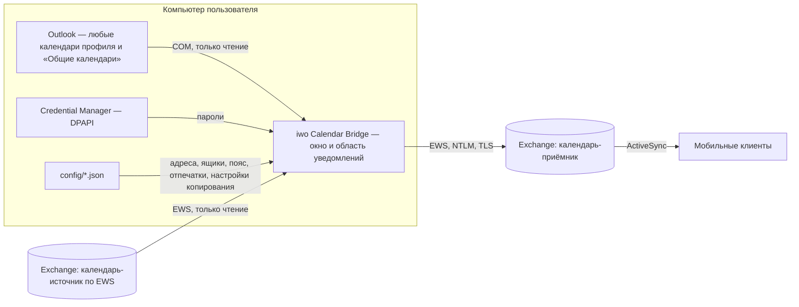
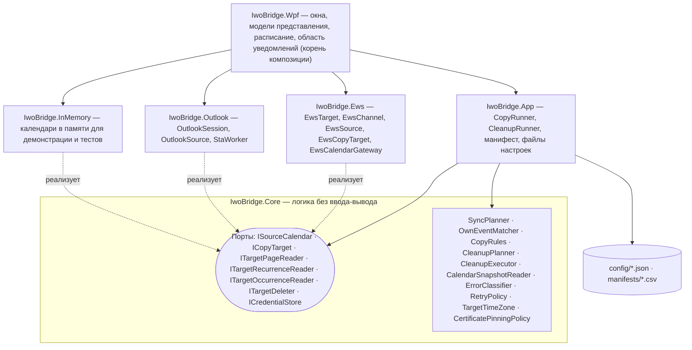
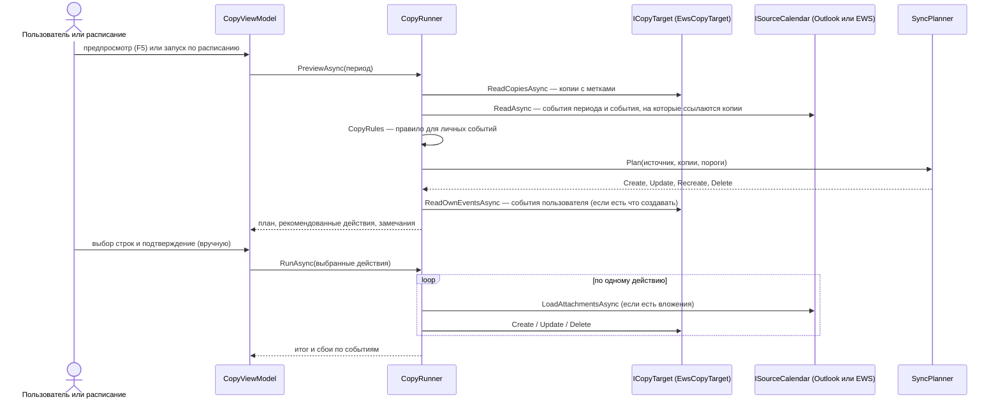
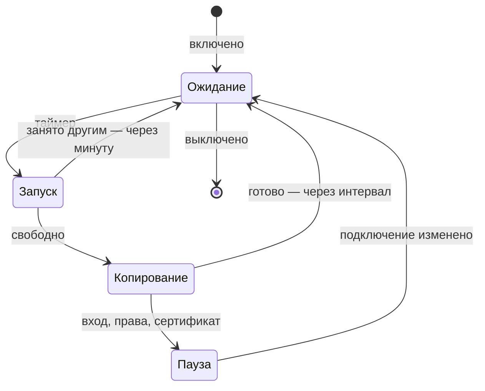
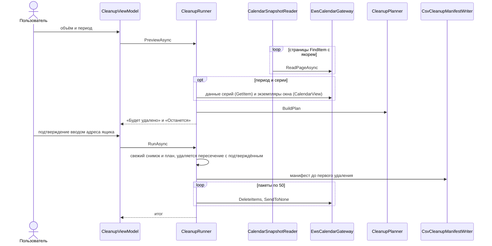
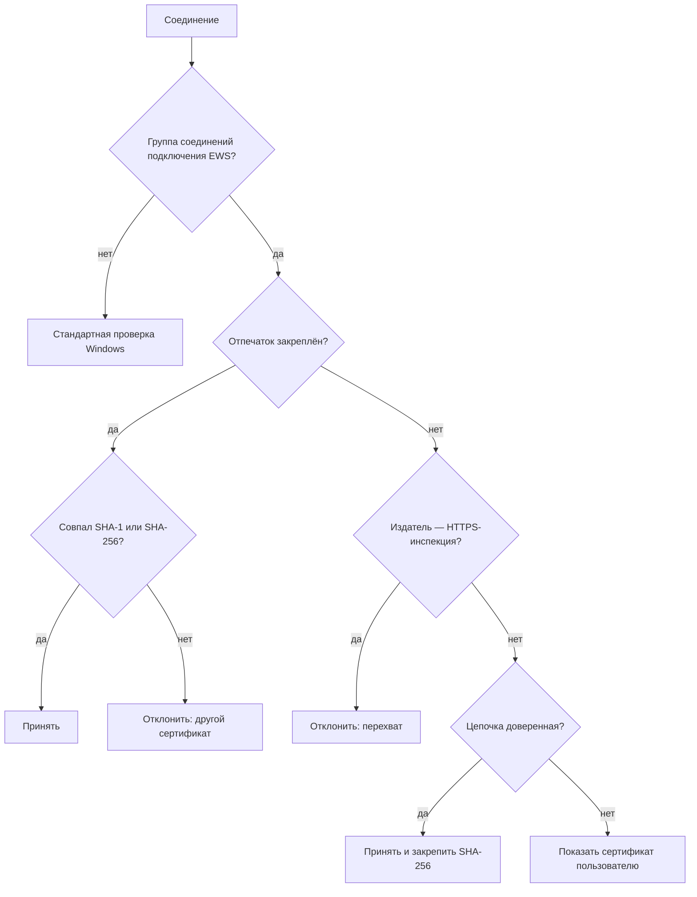

# Архитектура

Документ описывает устройство кода: слои, порты, адаптеры, потоки данных и основные решения. Схемы приведены
на языке Mermaid и отображаются на GitHub.

## Принципы

- **Порты и адаптеры.** Ядро не зависит от внешних систем. EWS, Outlook и календарь в памяти подключаются
  через порты, зависимости направлены внутрь, к ядру.
- **Разделение ответственности.** `IwoBridge.Core` не ссылается на EWS, COM и WPF. Время нормализуется в
  `TimeMapper`, пояс и границы периода считает `TargetTimeZone`, попадание в период определяет `TimeWindow`.
- **Одно правило — одна реализация.** Попадание в период, полнота ответов, оценка пакетного удаления,
  классификация ошибок, отпечаток содержимого, разбиение на пакеты.
- **Простота.** Планирование очистки и синхронизации — чистые функции от прочитанных данных. Порты появляются
  вместе с адаптерами, которые их реализуют.
- **Сначала чтение, затем запись.** Изменения выполняются по полностью прочитанным данным и в объёме,
  который подтвердил пользователь или правило автокопирования.

## 1. Контекстная схема

Копии пишутся в основной календарь ящика-приёмника, его видят Outlook, OWA и мобильные клиенты.

## 2. Слои и порты

Архитектурные тесты держат эту схему: у каждой сборки белый список ссылок. Ядро ссылается только на базовые
сборки .NET Framework, EWS Managed API разрешён только `IwoBridge.Ews`, позднее связывание COM — только
`IwoBridge.Outlook`, WPF и WinForms — только приложению, адаптеры не ссылаются друг на друга.

## 3. Ядро

| Область | Типы | Назначение |
|---|---|---|
| Time | `TimeMapper`, `TargetTimeZone`, `TimeWindow` | Нормализация к UTC, пояс календаря из профиля, границы периода, правило попадания в период |
| Model | `TargetItemInfo`, `TargetOccurrence`, `OccurrenceSpan`, `ItemKind` | Неизменяемые описания элементов приёмника и экземпляров серий, время в UTC |
| Configuration | `ConnectionProfile`, `ServerEndpoint`, `ServerAddress` | Адрес EWS и резервный адрес (у каждого свой отпечаток), ящик, смещение пояса |
| Transport | `Thumbprint`, `CertificateFingerprint`, `CertificatePinningPolicy` | Нормализация и сравнение отпечатков SHA-1 и SHA-256, первое закрепление, распознавание HTTPS-инспекции |
| Security | `CredentialSecret`, `ICredentialStore` | Учётные данные (домен отдельно для NTLM) и порт их хранилища |
| Errors | `OperationErrorKind`, `ErrorClassifier`, `RetryPolicy` | Классификация, повторы временных ошибок с паузами 1, 2, 4… с (до 60 с или по подсказке сервера), признаки «остановить пакет» и «нужен человек» |
| Reading, Paging | `CalendarSnapshotReader`, `CompletenessGuard`, `BatchDeleteOutcome` | Постраничный обход с якорем и повтором при сдвиге, строгая проверка полноты чтения и удаления |
| Cleanup | `CleanupPlanner`, `CleanupExecutor`, `CleanupPlan` | Планирование очистки и пакетное удаление |
| Sync | `SourceItem`, `RecurrenceRule`, `SyncContent`, `MapiRtf`, `CopyRules`, `SyncPlanner`, `OwnEventMatcher`, `ISourceCalendar`, `ICopyTarget` | Модель события источника, отпечаток содержимого, правила для личных событий, план синхронизации, сверка с событиями пользователя |

Логика ядра — чистые функции и неизменяемые типы. Изменяемое состояние есть только в адаптерах и приложении,
и доступ к нему упорядочен (семафор канала EWS, поток STA Outlook, поток интерфейса).

## 4. Копирование

- **Сопоставление.** Копия хранит `IwoBridgeSourceId` и `IwoBridgeContentHash` (extended properties). Если
  отпечаток изменился, копия перезаписывается. Серия при изменении пересоздаётся. Копии, которых больше нет в
  источнике, удаляются.
- **События пользователя.** `OwnEventMatcher` сравнивает новые события с событиями приёмника без меток (вид,
  начало, конец, тема). Совпадения не входят в рекомендованные действия.
- **Пороги.** План с большим числом удалений выполняется только после явного подтверждения. Если источник
  прочитан не полностью, план строится без удалений.
- **Запись в EWS.** Событие, вложения и исключения серии записываются как одно целое. При сбое созданная
  копия удаляется, при перезаписи отпечаток пишется последним запросом. Время пишется в поясе календаря
  приёмника (`CalendarZones`, классические ID зон Windows), описание — исходным RTF (`MapiRtf`).
- **Остановка.** «Остановить» прерывает чтение сразу, запись — после текущего события.

## 5. Автокопирование

`AutoCopyViewModel` ведёт расписание на однократном `DispatcherTimer`: следующий запуск назначается после
окончания текущего. Сам запуск выполняет `CopyViewModel.RunScheduledAsync`. Он ждёт, если идёт другая
операция или открыт модальный диалог, перечитывает список календарей Outlook и сдвигает период от текущей
даты. Календарь Outlook выбирается по EntryID папки. `TrayIcon` показывает значок, меню и уведомления о
проблемах. `RegistryAutostart` пишет запуск с ключом `--tray` в `HKCU\…\Run`.

## 6. Очистка

Серия целиком в периоде удаляется мастером. Серия на границе периода обрезается удалением экземпляров внутри
периода (по UID, с учётом перенесённых исключений). Неполное чтение на любом шаге оставляет календарь без
изменений.

## 7. Проверка сертификата

`TlsTrustRegistry` регистрирует одну проверку на процесс и выбирает правило по группе соединений запроса. У
каждого адреса каждого подключения своя группа и своё закрепление. Несовпадение имени в сертификате с адресом
допускается, так как к серверу часто подключаются по IP.

## 8. Адаптеры

- **EWS (`IwoBridge.Ews`).** `EwsTarget` — единственная точка входа приложения. Он создаёт сервисы для каждого
  адреса, канал чтения в UTC и канал записи в поясе календаря. `EwsChannel` выполняет запросы по одному
  (семафор), переходит на резервный адрес при сетевой недоступности и повторяет временные ошибки по
  `RetryPolicy`. Создание копии не повторяется автоматически. Схема запросов — `Exchange2007_SP1`, она
  поддерживается серверами 2007 SP1 … 2013. Протокол TLS выбирает Windows.
- **Outlook (`IwoBridge.Outlook`).** Позднее связывание COM, все вызовы в одном потоке STA (`StaWorker`) с
  фильтром сообщений. Вызов ограничен по времени, зависший поток заменяется новым. После перезапуска Outlook
  подключение восстанавливается. Таблица папки (`GetTable`) даёт быстрый перечень, затем открываются только
  отобранные события. Каждый объект COM освобождается сразу (`Com.Release`).
- **В памяти (`IwoBridge.InMemory`).** Реализует те же порты и воспроизводит поведение EWS на границах:
  перечисление без данных серий, надмножество CalendarView, удаление мастера и экземпляра, отсутствующий id.

## 9. Приложение с окнами

Exe `IwoCalendarBridge`, .NET Framework 4.8, Windows 7 SP1+, x86 и x64. Корень композиции — `App`, только
там создаются реальные реализации портов. Модели представления не используют типы WPF и тестируются без окна.

| Слой | Типы | Назначение |
|---|---|---|
| Модели представления | `MainViewModel`, `CopyViewModel`, `AutoCopyViewModel`, `CleanupViewModel`, `ConnectionViewModel`, `DeletionConfirmationViewModel` | Вкладки, подключения, копирование, расписание, очистка, подтверждения |
| Службы | `ITargetSession`, `ITargetConnector`, `ISettingsStore`, `IMailboxStores`, `ICopySettingsStore`, `IOutlookCalendars`, `IOneShotTimer`, `IAutostart`, `IDialogService` | Сеть, файлы, Outlook, таймер, реестр и окна за портами |
| Окна | `MainWindow`, `CopyPage`, `ConnectionWindow`, `ConfirmDeletionWindow`, `QuestionWindow`, `HelpWindow`, `TrayIcon` | Разметка, в коде окон только то, что требует WPF |
| Вид | `FillPanel`, `WindowSizing`, `Theme`, `Announce` | Адаптивная страница, окна в пределах экрана, высокая контрастность, озвучивание |
| Тексты | `ErrorMessages`, `UserMessage`, `RussianText` | «Что случилось, что делать, подробности» для каждого вида ошибки, числа, даты, склонения |

## 10. Тестирование

- **Ядро и сценарии** — на синтетических данных и календарях в памяти.
- **EWS** — мапперы, ошибки, правила повторения, проверка сертификата на сгенерированных сертификатах,
  переход на резервный адрес на реальном HTTP-стеке.
- **Outlook** — маппинг правил повторения.
- **Окна** — модели представления без окна, расписание на подставном таймере, разметка в настоящих окнах вне
  экрана на нескольких размерах (ошибки привязок, достижимость кнопок, виртуализация, Alt-клавиши, видимость
  для UI Automation).
- **Live-тесты** — по переменным окружения `IWO_LIVE_*`, запись только во временную папку календаря.
- **CI** — восстановление пакетов по lock-файлам, сборка Release, тесты, упаковка x86 и x64.

