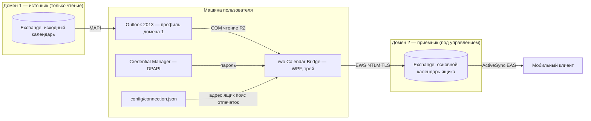
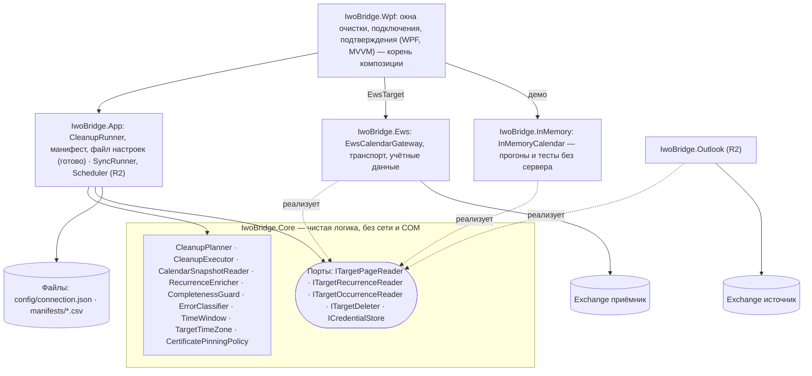
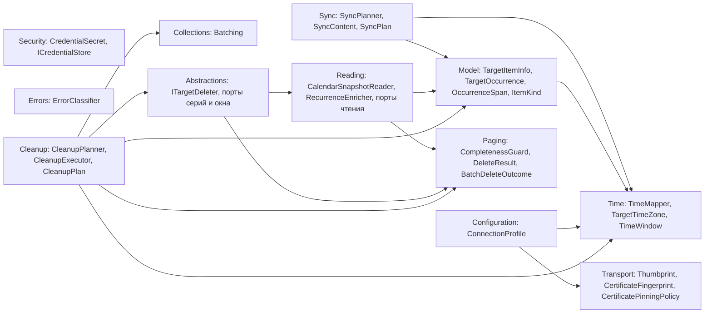
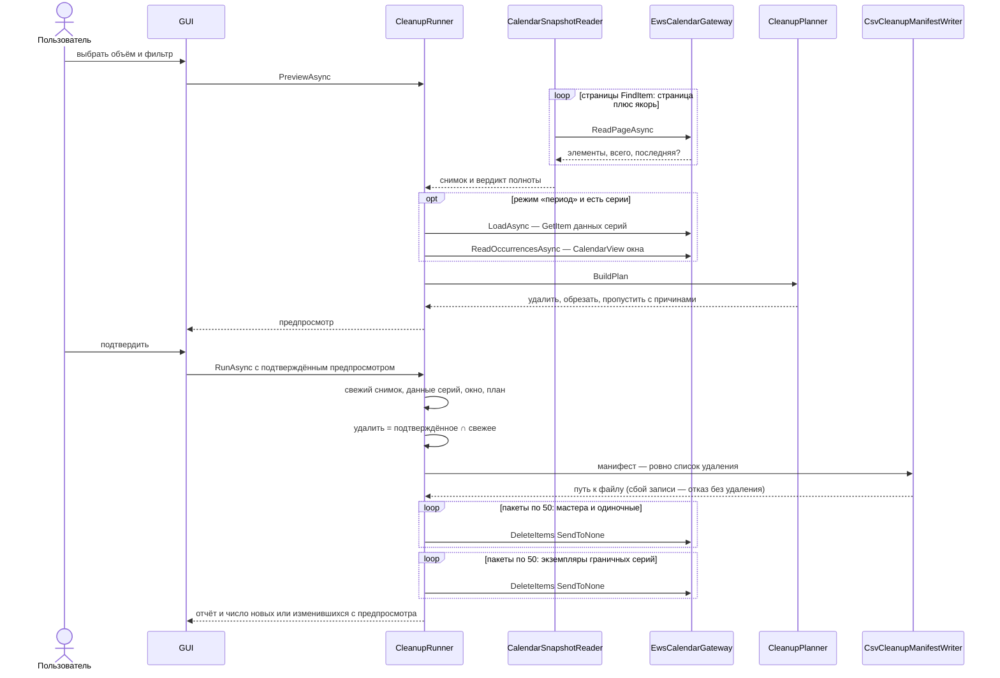
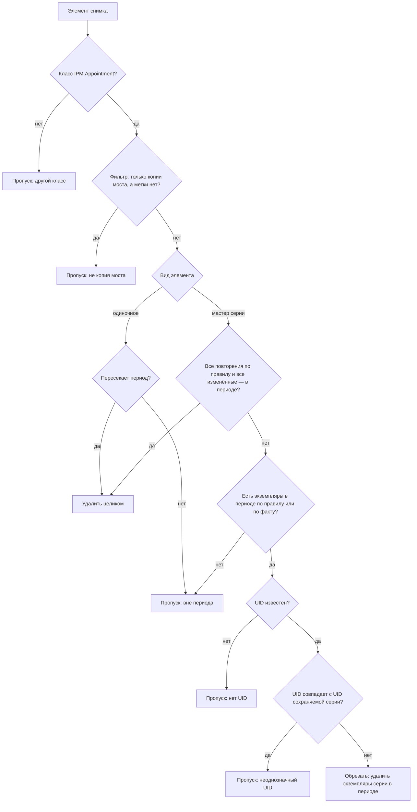
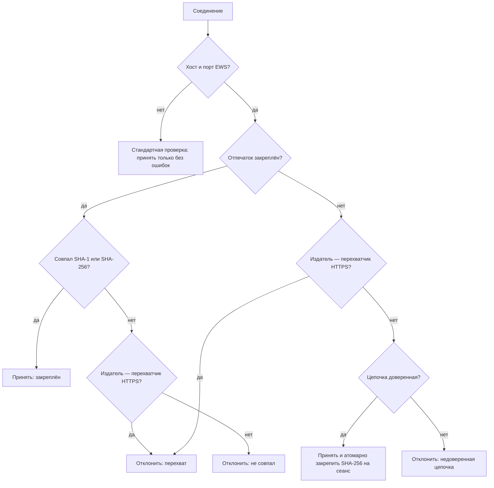
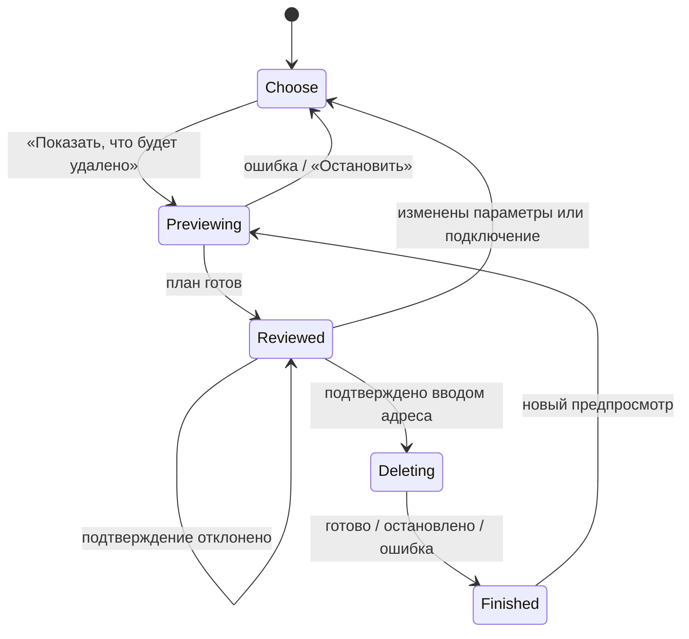

# Архитектура

Документ описывает устройство кода и содержит структурные схемы. Цель, границы и обоснования решений —
в [PLAN.md](PLAN.md); реестр ловушек интеграции (T1–T36) — там же, на него ссылаются комментарии в коде.

Схемы приведены на языке Mermaid и рендерятся на GitHub и в большинстве просмотров Markdown.

## Принципы

- **Гексагональная схема (порты и адаптеры).** Ядро не зависит от внешних систем; EWS, Outlook и
  ин-мемори календарь подключаются через порты. Зависимости направлены внутрь, к ядру (DIP).
- **SoC.** `IwoBridge.Core` не ссылается ни на Outlook Interop, ни на EWS. Время нормализуется только в
  `TimeMapper`, пояс и границы периода — только в `TargetTimeZone`, попадание в период — только в `TimeWindow`.
- **DRY.** Одна реализация на правило: попадание в период, полнота ответов, оценка пакетного удаления,
  классификация ошибок, нормализация отпечатка, разбиение на пакеты.
- **KISS/YAGNI.** Одна пара календарей; планирование — одна чистая функция; порты вводятся по мере появления
  адаптеров; никаких данных организации в продукте (мультиарендность, T36).
- **Сначала чтения, потом записи.** Разрушительная операция выполняется только по полным данным и только в
  объёме, подтверждённом пользователем.

## 1. Контекстная схема

Что с чем соединяется и через какие протоколы. Источник (домен 1) только читается; приёмник (домен 2)
под нашим управлением; мобильный клиент читает приёмник по ActiveSync, поэтому писать нужно в основной
календарь ящика.

## 2. Порты и адаптеры

GUI и сценарии опираются на ядро; внешние системы подключены через порты, которые реализуют адаптеры.
Пунктир — «реализует порты», сплошная — «вызывает/зависит».

## 3. Структура ядра

Пространства имён `IwoBridge.Core` и зависимости между ними. Граф ацикличен.

| Область | Типы | Назначение |
|---|---|---|
| Time | `TimeMapper`, `TargetTimeZone`, `TimeWindow` | Нормализация к UTC; пояс приёмника из профиля и границы периода; единое правило попадания события в период |
| Model | `TargetItemInfo`, `TargetOccurrence`, `OccurrenceSpan`, `ItemKind`, `TargetDeleteMode` | Неизменяемые описания элементов приёмника, экземпляров окна и изменённых повторений; время в UTC |
| Configuration | `ConnectionProfile`, `ServerEndpoint`, `ServerAddress` | Адрес EWS и необязательный резервный (у каждого свой отпечаток), ящик, смещение пояса — только из настроек |
| Transport | `Thumbprint`, `CertificateFingerprint`, `CertificateDecision`, `CertificatePinningPolicy` | Нормализация отпечатка (включая невидимые символы), сравнение SHA-1/SHA-256, TOFU, детект перехвата HTTPS |
| Security | `CredentialSecret`, `ICredentialStore` | Учётные данные (домен отдельно для NTLM) и порт их хранилища |
| Paging | `Completeness`, `CompletenessGuard`, `DeleteResult`, `BatchDeleteOutcome` | Строгая проверка полноты перечисления и пакетного удаления |
| Collections | `Batching` | Разбиение на пакеты — одно место |
| Errors | `OperationErrorKind`, `ErrorCategory`, `ErrorClassifier`, `RetryPolicy` | Классификация; повторы только временных ошибок (1, 2, 4… с, до 60 с или по подсказке сервера); аутентификация не повторяется |
| Reading | `TargetPage`, `TargetSnapshot`, `RecurrenceInfo`, `OccurrenceReadResult`, `CalendarSnapshotReader`, `RecurrenceEnricher`, `ITargetPageReader` | Постраничный обход с якорем и повтором при сдвиге; обогащение мастеров данными серий |
| Abstractions | `ITargetDeleter`, `ITargetRecurrenceReader`, `ITargetOccurrenceReader` | Порты удаления, данных серий и раскрытия окна |
| Cleanup | `CleanupPlanner`, `CleanupExecutor`, `CleanupScope`, `CleanupFilter`, `CleanupPlan`, `SkippedItem` | Чистое планирование очистки и пакетное удаление со строгой оценкой |
| Sync | `SyncPlanner`, `SyncPlan`, `SyncAction`, `SyncOptions`, `SourceEvent`, `BridgeCopy`, `SourceSnapshot`, `SyncContent` | Точечная синхронизация за период: разница источника и копий моста, защита от массового удаления; отпечаток содержимого |

Логика ядра — чистые функции и неизменяемые типы без разделяемых мутаций: гонки и утечки исключены по
построению. Мутации есть только в адаптерах, и там они защищены (семафор в EWS-адаптере, блокировка в
ин-мемори адаптере, атомарное закрепление в валидаторе сертификата).

## 4. Поток очистки (R1)

Сначала все чтения, потом записи. Пользователь подтверждает предпросмотр; перед удалением строится свежий
план, и удаляется только пересечение подтверждённого и свежего (T30). Неполные данные на любом шаге —
безопасный отказ без удаления (T2, T15).

## 5. Планирование очистки: решение по одному элементу

Логика `CleanupPlanner` для каждого элемента снимка в режиме «период». Принадлежность периоду —
`TimeWindow.Overlaps`; экземпляры серий сопоставляются по UID только среди повторений и исключений.

## 6. Проверка сертификата сервера

`EwsCertificateValidator` регистрируется процессно один раз, поэтому прочие HTTPS-соединения процесса
проверяются стандартно; закрепление действует только для хоста и порта EWS. Политика —
`CertificatePinningPolicy` (чистая). Несовпадение имени сертификата с адресом подключения игнорируется
(подключаются часто по IP, сертификат на имя сервера); доверие даёт закрепление отпечатка.

## Слой сценариев (`IwoBridge.App`)

| Область | Типы | Назначение |
|---|---|---|
| Cleanup | `CleanupRunner`, `CleanupPreview`, `CleanupResult` | Предпросмотр → подтверждение → свежая сверка → манифест → удаление пересечения |
| Cleanup | `ICleanupManifestWriter`, `CsvCleanupManifestWriter`, `CleanupManifestEntry` | Порт и CSV-реализация манифеста удаляемого: атомарная запись, защита от формул, время в поясе приёмника |
| Configuration | `ConnectionProfileFile`, `ProfileLoadException` | Чтение и атомарная запись `config/connection.json`; ошибка называет поле и не содержит значений |
| Cleanup | `CleanupProgress`, `CleanupStage`, `CleanupLabels` | Ход работы по этапам; слова для человека — одни в окне и в манифесте |

Файловые операции живут здесь, а не в ядре: ядро остаётся без ввода-вывода. Манифест — порт, поэтому
сценарий тестируется без файлов, а формат файла — отдельно.

## Приложение с окнами (`IwoBridge.Wpf`)

Exe `IwoCalendarBridge`, .NET Framework 4.8, Windows 7 SP1+, сборки x86 и x64. Корень композиции — `App`:
только здесь создаются реальные реализации портов. Модели представления не используют типы WPF и тестируются
без окна; окна только привязываются к ним.

| Слой | Типы | Назначение |
|---|---|---|
| Модели представления | `MainViewModel`, `CleanupViewModel`, `ConnectionViewModel`, `DeletionConfirmationViewModel`, `PlanRow`, `OffsetOption` | Шаги очистки и правила безопасности экрана; поля подключения, проверка, доверие к сертификату |
| Службы | `ITargetSession` (`EwsSession`, `DemoSession`), `ITargetConnector` (`EwsConnector`), `ISettingsStore` (`AppSettingsStore`), `IDialogService`, `IConnectionDialog` | Подключение, настройки, окна — за портами, чтобы модели не зависели от сети, файлов и окон |
| Тексты | `ErrorMessages`, `UserMessage`, `RussianText` | «Что случилось / что делать / подробности» на каждый вид ошибки; числа, даты, склонения |
| Окна | `MainWindow`, `ConnectionWindow`, `ConfirmDeletionWindow`, `WpfDialogService` | Разметка; в коде окна — только пароль, закрытие и ожидание остановки |
| Вид | `FillPanel`, `WindowSizing`, `Theme`, `Announce` | Адаптивная страница (список заполняет окно, в маленьком окне прокручивается страница), окна не больше экрана, высокая контрастность, озвучивание сообщений |
| Сбои | `CrashLog` | Журнал непредвиденных ошибок `logs\crash.log` рядом с программой |

Шаги экрана очистки (`CleanupStep`):

Окно «Подключение»: поле «Сервер» принимает внутренний или внешний адрес любого вида (`ServerAddress`).
«Сохранить» = проверка (`GetFolder` календаря) → сохранение профиля в файл и пароля в диспетчер учётных
данных. Недоверенный сертификат показывается с отпечатками и кнопкой «Доверять»; недоступный сервер — вопрос
«сохранить без проверки?».

## Адаптеры

- **EWS (`IwoBridge.Ews`), готов к интеграционной проверке.** Точка входа для приложения — `EwsTarget`: создаёт
  сервис, регистрирует проверку сертификата, отдаёт шлюз и сведения о сертификате; типов EWS Managed API за его
  пределами нет. `EwsCalendarGateway` реализует порты чтения,
  данных серий, раскрытия окна и удаления. Все вызовы EWS сериализуются семафором: безопасность экземпляра
  `ExchangeService` при параллельном использовании не гарантируется, а NTLM привязан к соединению.
  `ExchangeServiceFactory` задаёт схему `Exchange2007_SP1` (совместимо с 2007 SP2 … 2013), пояс UTC и
  NTLM-учётные данные с доменом отдельным полем; процессных настроек TLS не меняет — протокол выбирает ОС
  (SystemDefault). Проверка сертификата — одна на процесс (`TlsTrustRegistry`): она выбирает проверку
  подключения по группе соединений запроса, у каждого `EwsTarget` группа своя, поэтому пробное подключение и
  действующий сеанс не мешают друг другу. Временные ошибки повторяются по `RetryPolicy` (ядро), ошибки входа —
  никогда. Необязательный резервный адрес: у каждого адреса своя группа соединений и своё закрепление
  сертификата; если адрес недоступен по сети (`ErrorClassifier.IsUnreachable`), шлюз сразу повторяет запрос по
  другому адресу и остаётся на нём — до повторов с паузами. `WindowsCredentialStore` читает учётные данные из диспетчера Windows.
- **Ин-мемори (`IwoBridge.InMemory`), готов.** Реализует те же порты и повторяет важное поведение EWS:
  перечисление без данных серий, надмножество CalendarView на границе окна, удаление мастера целиком и
  экземпляра отдельно, «уже отсутствует» для неизвестного id.
- **Outlook (`IwoBridge.Outlook`, R2).** Источник, только чтение; COM в одном STA-потоке с `IMessageFilter`.
- **Хранилище (`IwoBridge.Storage`, R2).** SQLite (WAL) как кэш сопоставления и журнал — не второй источник правды.

## EAS и EWS

Приёмник читается мобильным клиентом по ActiveSync (EAS), поэтому запись и очистка идут в **основной
календарь** ящика (EAS-клиент видит только его). Серии удаляются мастером целиком либо обрезаются удалением
отдельных экземпляров — без «осиротевших» элементов. Сами операции выполняются по EWS; формы запросов
сверены с документацией Microsoft и с реально работающим EAS/EWS-клиентом (см. PLAN.md §3).

## Выпуски

- **R1** — очистка основного календаря (адаптер EWS, сценарий, окна — готовы; впереди проверка на сервере).
- **R2** — односторонняя синхронизация (адаптер Outlook, хранилище, планировщик, запись по EWS). Готов
  планировщик точечной синхронизации за период `Core.Sync.SyncPlanner` и отпечаток содержимого `SyncContent`
  (правила — PLAN.md §5); адаптеры чтения Outlook и записи в EWS — впереди.
- **R3** — стабилизация, длительные прогоны, сценарии отказов, приёмка.

## Тестирование

Тесты на синтетических данных: ядро (`IwoBridge.Core.Tests`), сценарий очистки поверх ин-мемори адаптера,
манифест и загрузчик настроек, включая контракт с поставляемым шаблоном (`IwoBridge.App.Tests`), адаптер
EWS — мапперы, ошибки, валидатор сертификата на сгенерированных сертификатах, фабрика сервиса
(`IwoBridge.Ews.Tests`). Для ключевых защит выполнена мутационная проверка: отключение каждой из них
роняет хотя бы один тест.

Модели окон (`IwoBridge.Wpf.Tests`) проверяются без окна: шаги экрана очистки, подтверждение, окно
«Подключение» с подставным сервером, тексты ошибок для каждого вида, демонстрационный режим. Разметка окон
проверяется на настоящих окнах за пределами экрана (`UiLayoutTests`): ошибки привязок, четыре размера окна,
виртуализация списка, достижимость кнопок, Alt-буквы, палитра высокой контрастности. Вид окон проверяется
снимками в демонстрационном режиме (`build\ui-walk.ps1`, размер окна — `-Width`/`-Height`).

Архитектурные тесты (`IwoBridge.Architecture.Tests`) держат схему §2 и §3: у каждой продуктовой сборки
белый список фактических ссылок — ядро ссылается только на базовые сборки .NET Framework, EWS разрешён
только адаптеру EWS, WPF — только приложению с окнами, Outlook Interop — нигде, адаптеры не ссылаются друг на
друга. Проект в `src` без правила роняет тест.

CI (`.github/workflows/ci.yml`, Windows) на каждый push и pull request восстанавливает пакеты строго по
`packages.lock.json`, собирает Release и прогоняет все тесты; сервер и данные установки не используются. Сетевые вызовы EWS проверяются интеграционными тестами
строго по тестовой подпапке календаря (впереди). Критерии готовности — в [WORKPLAN.md](WORKPLAN.md).
